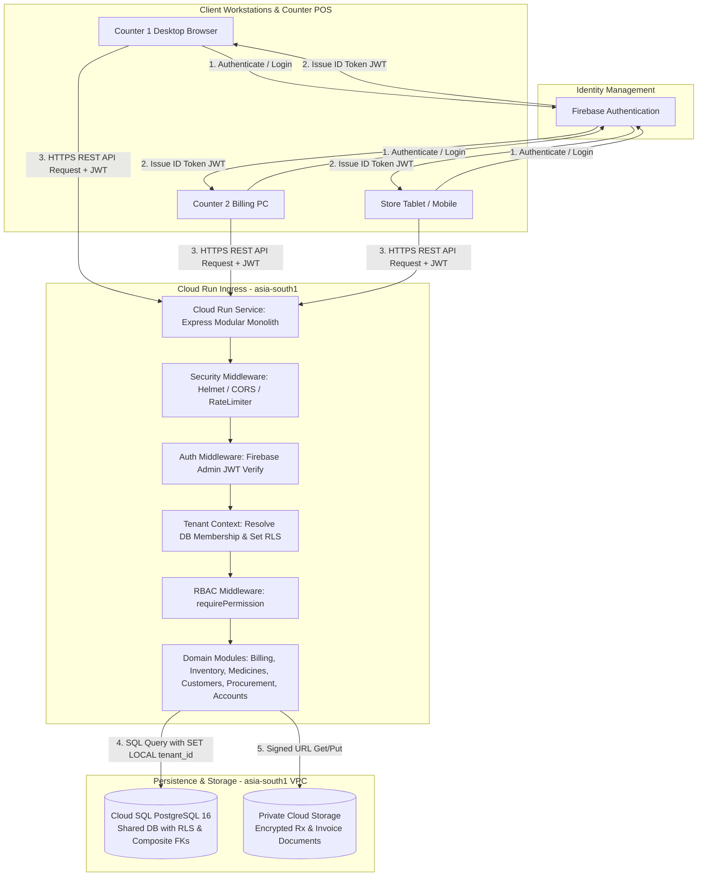
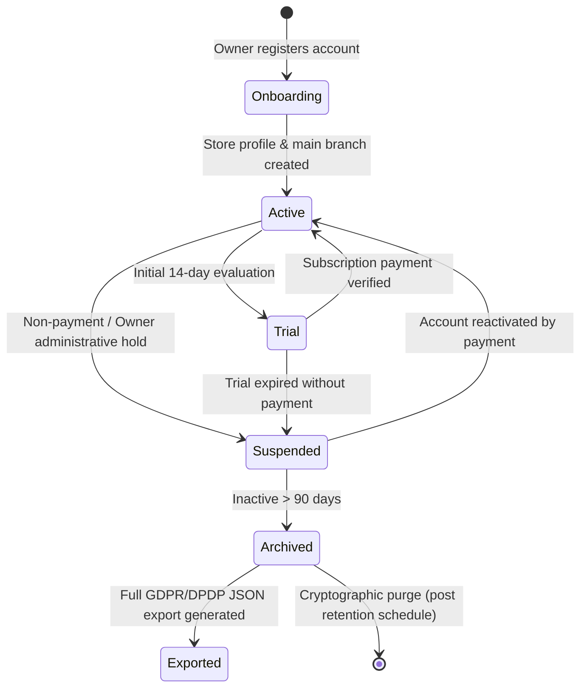

# PharmaDesk Cloud Architecture & System Topology

**Document Version:** 2.0.0 (Hardened Production Blueprint)  
**Target Environment:** Google Cloud Platform (GCP) — Region: `asia-south1` (Mumbai, India)  
**System Pattern:** Modular Monolith on Managed Cloud Services  
**Classification:** Core System Architecture Specification  

---

## 1. System Vision & Architecture Overview

PharmaDesk is a multi-tenant Software-as-a-Service (SaaS) pharmacy management platform engineered for Indian independent retail medical stores, medium pharmacies, and multi-branch pharmacy chains.

PharmaDesk is not merely billing software; it operates the entire retail pharmacy business: store operations, employee role management, medicine cataloguing, batch-level inventory, expiry management, POS dispensing, patient history and Khata credit ledgers, procurement, goods receipts, accounts, expenses, GST reporting, and audit logs.

The technical stack preserves the existing repository foundations:
- **Client Frontend:** Single Page Application (SPA) built with React 19, TypeScript, Vite, and Tailwind CSS v4.
- **Backend Service:** Modular Monolith built with Node.js, TypeScript, and Express.
- **Relational Persistence:** PostgreSQL on Google Cloud SQL (`asia-south1`).
- **Identity & Authentication:** Firebase Authentication (handling identity, credential verification, and token issuance).
- **Object Storage:** Private Google Cloud Storage (`asia-south1`) with signed URL access.
- **Execution & Hosting:** Google Cloud Run (containerized stateless backend).



### 1.3 Firebase Managed Services Layer & Dual-Tier Boundary
PharmaDesk utilizes Firebase as an integrated managed services tier for edge identity, client attestation, messaging, and real-time operational signals, while strictly maintaining PostgreSQL as the sole authority for business transactions and financial ledgers.

* **Firebase Authentication:** Handles phone SMS OTP and email identity; issues RS256-signed JWTs.
* **Firebase Admin SDK:** Server-side token verification and user management within Cloud Run.
* **Cloud Firestore:** Approved strictly for non-financial real-time operational collaboration (counter workstation presence, draft terminal locks, in-store live alerts). Critical transactional records (invoices, batch stock counts, customer ledger entries, accounting journals) are **strictly forbidden** in Firestore.
* **Firebase Cloud Messaging (FCM):** Push notifications for low stock, near-expiry alerts, and customer debt settlement notices. Payloads strictly exclude patient health information (zero PHI/drug names).
* **Firebase App Check:** Attests client requests (reCAPTCHA Enterprise on Web) to defend against bot scraping and automated abuse.
* **Firebase Analytics:** Anonymized, DPDP-compliant telemetry with zero patient names, drug salts, or financial values.
* **Firebase Hosting:** Optional high-speed CDN delivery for static React assets with automated API rewrites to Cloud Run.
* *Detailed Specification:* Refer to `docs/firebase-services-architecture.md`.

---

## 2. Request & Response Architecture

### 2.1 Complete Request Flow
Every interaction between an employee and PharmaDesk follows a strict, verifiable request pipeline:

1. **Employee Browser (React 19 SPA):**
   - The user performs an operational action (e.g., searches a medicine, tenders a bill, records an inward receipt).
   - The client fetches the current user's valid Firebase ID Token (refreshed automatically in the background).
   - An HTTPS request is dispatched to `https://api.pharmadesk.in/api/v1/...` with headers:
     - `Authorization: Bearer <Firebase_ID_Token>`
     - `X-Tenant-ID: <Tenant_UUID>` (Active tenant workspace)
     - `X-Branch-ID: <Branch_UUID>` (Active retail store branch)
     - `X-Correlation-ID: <UUID>` (Distributed tracing identifier)
     - `Idempotency-Key: <UUID>` (Required for mutating billing, payment, and receipt endpoints)

2. **Backend Authentication & Identity Verification:**
   - Cloud Run terminates TLS 1.3 and invokes Express middleware.
   - `authenticateMiddleware` extracts the Bearer token and verifies its cryptographic signature via the Firebase Admin SDK using Google's public key cache.
   - Token revocation is enforced through check against token issue timestamp.

3. **Tenant & Membership Context Resolution (Database-Authoritative):**
   - The backend **does not rely on static claims alone** for tenant authorization.
   - The backend queries `tenant_memberships` and `membership_branches` in PostgreSQL using the verified `firebase_uid`.
   - The system verifies:
     1. Is the user's membership in this tenant `active`?
     2. Is the tenant's subscription status in good standing (`active` or `trial`)?
     3. Is the user permitted to access the requested `branch_id`?
   - If valid, the resolved context is attached to the request: `req.context = { tenantId, branchId, userId, role, permissions }`.

4. **Authorization Middleware (RBAC & User Overrides):**
   - The route's `requirePermission('billing.create')` middleware evaluates whether the resolved context holds the required capability.
   - Checks user-specific overrides (`user_permission_overrides`) first; if absent, checks role permissions (`role_permissions`).

5. **PostgreSQL Execution with Row-Level Security:**
   - The connection pool checks out a client connection.
   - Within an explicit transaction block, session context is set using transaction-scoped `SET LOCAL`:
     ```sql
     SET LOCAL app.current_tenant_id = '3fa85f64-5717-4562-b3fc-2c963f66afa6';
     SET LOCAL app.current_branch_id = 'c8b417e3-0599-4c46-9e90-c6d946faec99';
     ```
   - All SQL queries execute against composite tenant keys and are verified by database Row-Level Security.
   - When the transaction concludes via `COMMIT` or `ROLLBACK`, PostgreSQL automatically purges the `SET LOCAL` variables at the database engine level. Prepared statements and query plan caches are preserved across checkout cycles without issuing destructive `DISCARD ALL` commands. Sockets are released cleanly back to the pool.

6. **Response Dispatch:**
   - The backend formats the domain output into a standard JSON envelope or RFC 7807 error and returns HTTP 200/201/4xx/5xx to the browser.
   - The browser updates local React Query cache and re-renders the UI.

### 2.2 Client Storage Policy (No Permanent Business Data in Browser)
- **Strict Prohibition:** Medical store transactional records (sales invoices, customer Khata debt, inventory batch counts, supplier payables, medicine master catalogs) must **never** be stored permanently in browser `localStorage` or `sessionStorage`.
- **Allowed Uses of Browser Storage:**
  - Active session authentication tokens (managed securely by Firebase client SDK).
  - Harmless user interface preferences:
    - Sidebar collapsed state (`pharmadesk_ui_sidebar_collapsed`).
    - Invoice preview preference (`pharmadesk_ui_printer_preview_mode`: thermal vs A4).
    - Table density preference (`pharmadesk_ui_density`: compact vs standard).
  - Ephemeral form state during an active screen session (discarded upon logout or navigation).

---

## 3. Multi-Tenant Architecture & Data Isolation

PharmaDesk employs a **Shared Database, Shared Schema with Composite Foreign Keys and Row-Level Security (RLS)** architecture. This delivers extreme cost-efficiency and unified migrations for thousands of small pharmacies while establishing mathematically verifiable data isolation.

### 3.1 Tenant Lifecycle & State Machine
Every pharmacy is an autonomous tenant. The tenant lifecycle transitions through:



1. **Tenant Creation & Onboarding:**
   - When a pharmacy owner registers, a row is inserted into `tenants`, an initial row into `branches` (marked `is_main_branch = true`), and the owner is linked via `tenant_memberships` with role `OWNER`.
   - Onboarding supports incomplete state: optional identifiers (e.g. FSSAI or GSTIN if below taxable threshold) are not hard requirements to begin dispensing OTC formulations.
2. **Tenant Suspension:**
   - If a tenant subscription lapses, the tenant status becomes `suspended`.
   - Authentication middleware halts write and read operations across all branch terminals, rendering a clear subscription payment screen: `"Account Suspended — Please contact billing to reactivate."`
3. **Tenant Deletion & Data Export:**
   - In accordance with the Digital Personal Data Protection (DPDP) Act 2023, the owner can trigger `POST /settings/export` at any time.
   - A background worker packages the entire relational dataset (formularies, invoices, batches, customer Khata, supplier ledger) into a password-protected zip file containing clean CSVs/JSONs with an SHA-256 integrity checksum.
   - Deletion marks the tenant `archived` for statutory audit retention (Indian drug and tax laws require preserving historical invoices for at least 3 to 6 years), after which data is cryptographically expunged.

### 3.2 Cross-Tenant Access Prevention
Isolation is guaranteed at three distinct technical layers:
1. **Application Middleware:** All queries construct parameterized clauses with `tenant_id = $tenantId`.
2. **Composite Foreign Keys:** Tables enforce composite unique keys `(tenant_id, id)`. Foreign keys mandate `(tenant_id, foreign_id) REFERENCES parent(tenant_id, id)`. It is mathematically impossible for an invoice item in Tenant A to link to an inventory batch in Tenant B.
3. **Database Row-Level Security (RLS):** Policies on all operational tables restrict reads, updates, inserts, and deletes strictly to rows matching `tenant_id = current_setting('app.current_tenant_id')::UUID`.

---

## 4. Branch Architecture

PharmaDesk is designed so that a single-store medical pharmacy experiences zero unnecessary configuration overhead, while a multi-branch chain benefits from unified cataloguing and distributed inventory.

### 4.1 Tenant-Level vs. Branch-Level Data Ownership

| Data Domain | Scoping Level | Rationale |
| :--- | :---: | :--- |
| **Pharmacy Legal Entity** (`tenants`) | Tenant | Single business entity with corporate ownership and Master PAN. |
| **Master Medicine Formulary** (`medicine_master`) | Tenant | Standard formulations, salt compositions, and HSN codes are shared across all branches to eliminate duplicate data entry. |
| **Customer Master Directory** (`customers`) | Tenant | A patient who visits the Bandra store can purchase medicine at the Pune branch while maintaining their unified medical history. |
| **Supplier Directory** (`suppliers`) | Tenant | Approved pharmaceutical distributors and C&F stockists are shared across branches. |
| **System Roles & Permissions** (`roles`, `permissions`) | Tenant | The owner sets global organizational policies once. |
| **Branches** (`branches`) | Branch | Physical retail premises, local drug licenses (Form 20B/21B), invoice prefix (`AMB`), and printer configurations. |
| **Physical Stock Batches** (`inventory_batches`) | Branch | Inventory physically resides on specific shelves within a distinct branch. Branch A stock is distinct from Branch B stock. |
| **Rack Locations** (`rack_location`) | Branch | Physical shelf coordinates (e.g., "Rack A-2", "Cold Storage") pertain to the specific physical layout of that shop. |
| **Counter Sales Invoices** (`sales_invoices`) | Branch | Issued at the physical branch counter; numbered sequentially within that branch's legal sequence. |
| **Daily Cash Registers & Drawers** (`accounts`) | Branch | Cash in the counter drawer at Branch A must reconcile against Branch A's daily transactions. |
| **Goods Receipts** (`goods_receipts`) | Branch | Deliveries from distributors arrive physically at a specific store location. |
| **Stock Transfers** (`stock_transfers`) | Both | Source branch, destination branch, and common tenant tracking. |

### 4.2 Branch Access & Switching
- Single-branch medical stores have exactly one branch created automatically during onboarding (`is_main_branch = true`). The branch selector remains quiet and unobtrusive.
- Multi-branch employees are mapped through the `membership_branches` junction table.
- Pharmacists and cashiers see only branches they are explicitly assigned to. The Store Owner holds access across all branches.
- Multi-branch inventory transfers follow a formal two-phase transit workflow: `ISSUED` (stock leaves Source branch) $\rightarrow$ `IN_TRANSIT` $\rightarrow$ `RECEIVED` (stock enters Destination branch).

---

## 5. Cost-Conscious Cloud Infrastructure Sizing

To ensure business sustainability, PharmaDesk rejects premature enterprise over-provisioning. The architecture starts small with scale-to-zero capabilities and scales predictably based on measurable workload milestones.

### 5.1 Three-Tier Sizing Strategy

```
+---------------------------------------------------------------------------------------------------------+
|                                    PHARMADESK INFRASTRUCTURE EVOLUTION                                  |
+---------------------------------------------------------------------------------------------------------+
| 1. PILOT TIER (0 - 25 Pharmacies)                                                                       |
|    - Cloud Run: 1 Service, min-instances = 0 (scale to zero), max-instances = 3. Concurrency = 80.     |
|    - Cloud SQL: db-f1-micro or db-custom-1-3840 (1 vCPU, 3.75 GB RAM, 20 GB SSD). Single-zone.         |
|    - Cost Profile: ~$15 - $40 / month total. Maximum cost efficiency during development and pilot.      |
+---------------------------------------------------------------------------------------------------------+
                                                     |
                                                     v
+---------------------------------------------------------------------------------------------------------+
| 2. EARLY GROWTH TIER (25 - 200 Pharmacies)                                                              |
|    - Cloud Run: min-instances = 1 (eliminates cold starts during business hours), max-instances = 10.   |
|    - Cloud SQL: db-custom-2-7680 (2 vCPU, 7.5 GB RAM, 100 GB SSD). Daily automated backups + PITR.     |
|    - Cost Profile: ~$90 - $180 / month total. Serves high-velocity counter billing effortlessly.       |
+---------------------------------------------------------------------------------------------------------+
                                                     |
                                                     v
+---------------------------------------------------------------------------------------------------------+
| 3. SCALE-UP TIER (200 - 1,000+ Pharmacies)                                                              |
|    - Cloud Run: min-instances = 2, max-instances = 30. Cloud Armor WAF enabled.                         |
|    - Cloud SQL: db-custom-4-16384 (4 vCPU, 16 GB RAM, 250 GB SSD). High Availability (HA) Regional failover.|
|    - Cloud Memorystore (Redis): 1 GB instance for hot medicine catalogue and token revocation caching.|
|    - Cost Profile: Supported by paying customer subscription revenue.                                   |
+---------------------------------------------------------------------------------------------------------+
```

### 5.2 Service-by-Service Financial Evaluation

| Infrastructure Component | Pilot Tier | Growth Tier | Continuous vs. Scale-to-Zero | Cost Classification |
| :--- | :--- | :--- | :--- | :--- |
| **Cloud Run (API & Frontend)** | 0 to 3 instances | 1 to 10 instances | Scales to zero at night (Pilot); min 1 during daytime (Growth) | Variable (CPU-seconds + Requests) |
| **Cloud SQL PostgreSQL** | db-custom-1-3840 (Single Zone) | db-custom-2-7680 (Single Zone) | Runs continuously (databases must maintain persistent storage) | Fixed monthly baseline |
| **Cloud Storage (Documents)** | Standard Storage (< 5 GB) | Standard Storage (< 100 GB) | Serverless object storage | Variable ($0.026/GB in Mumbai) |
| **Firebase Authentication** | Spark / Blaze Free Tier | Blaze Pay-as-you-go | Serverless identity verification | Zero cost under 50k monthly active users |
| **Secret Manager** | < 10 secrets | < 20 secrets | API credential store | Negligible (< $0.50/month) |
| **Cloud Logging / Monitoring** | Default free allocation | Standard retention (30 days) | Automated log ingestion | Free up to 50 GiB/month |
| **VPC Serverless Connector** | micro connector | standard connector | Private VPC access between Cloud Run and Cloud SQL | Small fixed baseline (~$8/month) |

### 5.3 Services Unnecessary for Initial Launch (Explicitly Excluded)
1. **Kubernetes (GKE):** Excessive orchestration overhead and minimum cluster node fees. Cloud Run provides the exact containerized execution with zero idle node cost.
2. **Dedicated Microservices:** Splitting billing, inventory, and customers into separate services would multiply database connections, latency, and operational complexity without justification.
3. **Multi-Region Redundancy:** Indian data sovereignty laws and sub-20ms latency require deployment within India (`asia-south1` Mumbai). Multi-region across geographies introduces unnecessary complexity and latency.
4. **Heavyweight Redis Clusters:** At pilot scale, PostgreSQL handles full concurrency cleanly without caching infrastructure.

---

## 6. Online-First Product & Failure Mode Architecture

The initial release of PharmaDesk is an **online-first cloud application**. To ensure cashier trust and data integrity, it handles every network and system failure mode with explicit, deterministic behaviors rather than ambiguous loading spinners.

### 6.1 Failure Mode Matrix

| Failure Condition | System Behavior & Frontend Handling |
| :--- | :--- |
| **Internet Disconnection** | Active background ping detects connection loss within 3 seconds. Top bar displays an immediate non-intrusive persistent warning: `🔴 Connection Lost — Counter billing paused. Do not close browser.` All submit buttons (`Complete Bill`, `Inward Batch`) are disabled with an explicit tooltip explaining that internet connectivity is required. No partial data is lost; draft cart items remain in React component state. |
| **API Unavailable (Cloud Run 502/503/504)** | Network interceptor catches failed HTTP request and retries twice using exponential backoff (1s, 3s) for idempotent GET requests. For POST requests, the UI displays: `⚠️ Service Temporarily Unavailable — The server did not respond. Verify internet or retry in a few moments.` The idempotency key ensures retrying will not double-bill. |
| **Database Unavailable (Cloud SQL maintenance/failover)** | Backend returns HTTP 503 with standard RFC 7807 error `DATABASE_UNAVAILABLE`. Frontend modal announces: `Database Maintenance in Progress — System will resume automatically in < 60 seconds.` |
| **Session Expiry (Firebase JWT expired)** | Firebase SDK automatically refreshes tokens every 55 minutes. If a token refresh fails (e.g. employee password was changed or account deactivated), the request returns HTTP 401. A modal overlay prompts: `Session Expired — Re-enter credentials to continue dispensing without losing current cart.` |
| **Failed Billing Request (e.g. Stock exhaustion during checkout)** | If another cashier dispenses the last strip of a batch milliseconds prior, the transaction aborts with HTTP 409 Conflict: `STOCK_EXHAUSTED`. The cart flags the specific line item in red with current available stock and prompts the cashier to select an alternate batch or substitute formulation. |
| **Duplicate Submission (Cashier double-clicks "Print & Complete")** | Prevented by client-side button debounce AND guaranteed by server-side `idempotency_key` stored with unique index in `sales_invoices`. If the exact key is submitted twice, the server returns the previously created invoice record without re-decrementing inventory or re-charging Khata. |
| **Interrupted Goods Receipt (Network drops mid-inwarding)** | The entire goods receipt executes within a single database transaction (`BEGIN ... COMMIT`). If interrupted, PostgreSQL executes a complete rollback. The stockist invoice is not marked received, and stock counts remain untouched. The user is prompted: `Receipt incomplete — No inventory was altered. Please re-submit.` |

---

## 7. Required Architecture Decisions: Definitive Answers

### Q1: How does one owner create a pharmacy account?
The owner visits `app.pharmadesk.in`, enters their mobile number and email, and verifies a 6-digit OTP via Firebase Authentication. The client dispatches `POST /onboarding/pharmacy` with trade name, drug license Form 20B/21B, and main branch details. The backend creates the `tenants` record, establishes the `branches` record (marked `is_main_branch = true`), creates `tenant_memberships` assigning role `OWNER`, and seeds standard Indian formulary settings.

### Q2: How does an owner invite three or more employees?
The owner navigates to `Employees` $\rightarrow$ `Invite Employee`. They enter the employee's name, mobile number, role (`PHARMACIST`, `CASHIER`, `HELPER`), and permitted branches. The backend creates a record in `tenant_memberships` (status `invited`) and records mapped branches in `membership_branches`. A secure SMS/WhatsApp invitation link is dispatched. When the employee authenticates using their phone OTP, Firebase identity links to the pending membership.

### Q3: How can the same employee access multiple authorized branches?
Branches are decoupled from the user profile. The normalized junction table `membership_branches` links `(membership_id, branch_id)`. When an employee logs in, the API returns their permitted branches. In the top navigation bar, the employee can select their active branch workstation. All subsequent requests send `X-Branch-ID: <selected_branch_id>`, which the backend validates against `membership_branches`.

### Q4: How do we prevent one pharmacy from seeing another pharmacy's data?
By enforcing isolation across three independent layers:
1. Express middleware extracts `tenant_id` from the authenticated user's database membership.
2. Composite foreign keys `(tenant_id, foreign_id)` prevent any foreign key from pointing across tenant boundaries.
3. PostgreSQL Row-Level Security (RLS) executes `SET LOCAL app.current_tenant_id = :tenantId` on every connection pool checkout, rejecting any cross-tenant row access at the database engine level.

### Q5: How are customer purchases connected across months?
Customers are registered once at the tenant level in `customers`. When an invoice is created, it records `customer_id REFERENCES customers(id)`. Historical customer sales are queryable via `sales_invoices WHERE customer_id = :id`. The invoice and `sales_invoice_items` preserve the historical price and tax snapshot permanently, while `customers` maintains total visits, lifetime purchases, and outstanding Khata debt.

### Q6: How do we maintain batch-level inventory?
Every medicine formulation in `medicine_master` links to one or more physical stock records in `inventory_batches`. Each batch records `batch_number`, `expiry_date`, `pack_size`, `ptr`, `mrp`, `current_stock`, and `rack_location`. When inwarding stock from distributors, a batch is created or incremented. When dispensing at the POS counter, the cashier selects the exact batch, decrementing that specific batch's stock.

### Q7: How do we prevent two cashiers from overselling the same stock?
When an invoice is submitted, the backend opens an explicit transaction and executes pessimistic locking:
```sql
SELECT id, current_stock FROM inventory_batches WHERE id IN (...) FOR UPDATE;
```
If Counter 1 is processing a sale, Counter 2's request pauses until Counter 1 commits. If Counter 1 takes the remaining stock, Counter 2's transaction detects `current_stock < requested_quantity` and immediately raises an HTTP 409 Conflict. In addition, the database trigger `trg_check_inventory_stock` raises a hard exception if `current_stock < 0`.

### Q8: How are invoices numbered and stored?
Invoices are numbered strictly on the backend using atomic sequences scoped per branch and financial year:
`AMB-2026-1049`. Client-side counters are never trusted. The invoice header is saved in `sales_invoices`, and individual line items with full rate snapshots are saved in `sales_invoice_items`. Once committed, the record is immutable.

### Q9: How do payments and returns update financial records?
When an invoice is paid, a row is inserted into `payments`. If billed on credit, the customer's balance increases in `customer_ledger`. When a customer returns medicine, a row is created in `sales_returns`, a negative movement is logged in `stock_movements` (restoring inventory if non-damaged), and a refund or credit note is posted to `customer_ledger`.

### Q10: How are supplier and customer balances calculated?
Balances are maintained via double-entry append-only ledgers (`customer_ledger` and `supplier_ledger`). Each entry records a `debit`, `credit`, and verified `running_balance`. Fast lookups read the pre-computed balance column on `customers.khata_balance` and `suppliers.outstanding_balance`, which is validated by periodic reconciliations against the sum of ledger entries.

### Q11: How does the owner export pharmacy data?
The owner triggers `POST /settings/export`. A background worker reads all tenant-owned tables (`medicine_master`, `inventory_batches`, `sales_invoices`, `customers`, `suppliers`, `customer_ledger`), bundles them into a structured encrypted ZIP containing clean CSVs and JSONs, and uploads it to private Google Cloud Storage. A time-limited signed URL is delivered to the owner's authenticated session.

### Q12: What happens when a pharmacy cancels its subscription?
The tenant status transitions to `suspended`. All employee and counter sessions are blocked from creating new invoices or modifying stock. Data remains completely intact and read-only access for tax filing is granted to the Owner for 90 days. After 90 days, the tenant moves to `archived` where data is preserved in coldline storage for statutory audit retention before final expungement.

### Q13: What happens when an employee is deactivated?
The owner clicks `Deactivate` on the employee profile. The backend immediately sets `tenant_memberships.status = 'deactivated'` and revokes all branch mappings in `membership_branches`. The user's active session token is blacklisted in memory/Redis. On their next API request (or within 60 seconds), the employee's browser receives HTTP 403 and redirects to the login screen.

### Q14: How do we recover data after accidental deletion or infrastructure failure?
Google Cloud SQL maintains automated daily snapshots retained for 30 days and continuous Write-Ahead Logging (WAL) providing Point-In-Time Recovery (PITR) with 7-day granularity. If accidental data corruption occurs at 14:22:10 IST, the database can be restored to 14:22:09 IST. Weekly encrypted database dumps are archived to an immutable Cloud Storage Coldline bucket with Object Locking.

### Q15: How do we keep infrastructure costs reasonable as customer numbers grow?
By adhering strictly to a single modular monolith on Google Cloud Run paired with a rightsized PostgreSQL instance. Cloud Run scales dynamically to zero during low-traffic night hours. Multi-tenancy uses a shared schema with RLS rather than expensive database-per-tenant architectures. Expensive caching and Kubernetes clusters are omitted until customer subscription revenues mathematically justify their introduction.
