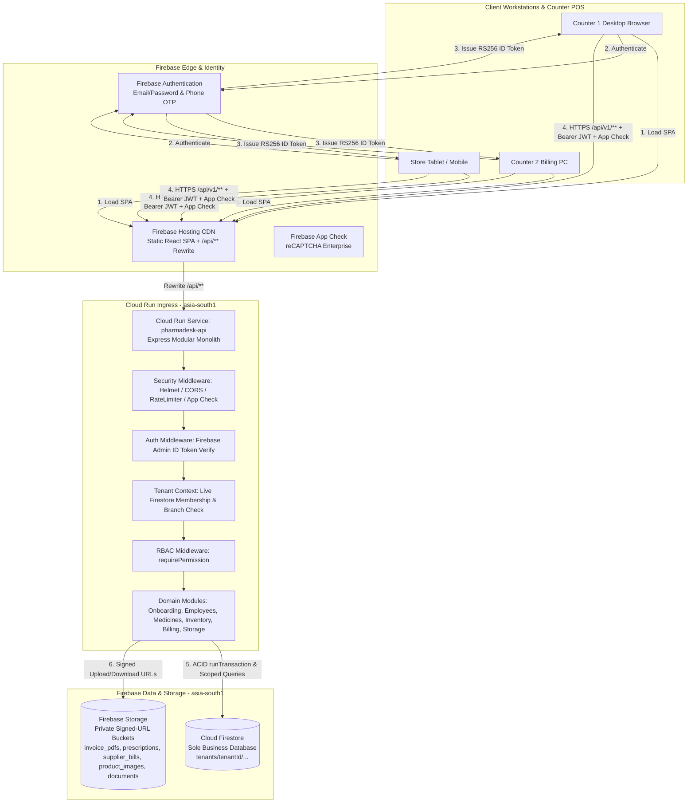
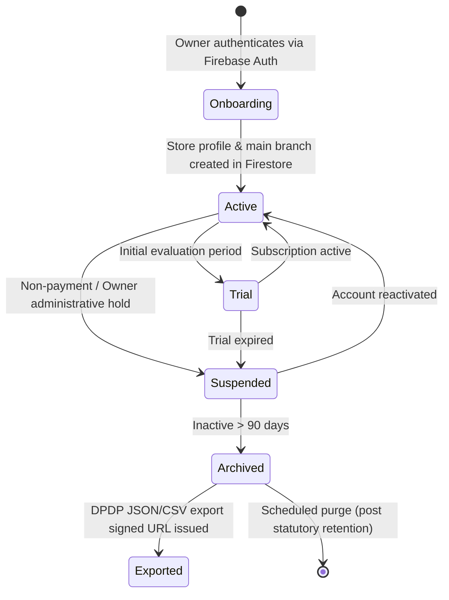

# PharmaDesk Cloud Architecture & System Topology

**Document Version:** 3.0.0 (Standardized Firebase + Cloud Run Blueprint)  
**Target Environment:** Firebase & Google Cloud Platform (GCP) — Region: `asia-south1` (Mumbai, India)  
**System Pattern:** Modular Monolith API on Cloud Run + Cloud Firestore + Firebase Hosting  
**Package Manager:** Bun (`bun.lock`)  
**Classification:** Core System Architecture Specification

---

## 1. System Vision & Architecture Overview

PharmaDesk is a multi-tenant Software-as-a-Service (SaaS) pharmacy management platform engineered for Indian independent retail medical stores, medium pharmacies, and multi-branch pharmacy chains.

PharmaDesk operates the entire retail pharmacy workflow: store operations, employee role management, medicine cataloguing, batch-level inventory, expiry management, POS dispensing, patient history and Khata credit ledgers, procurement, goods receipts, accounts, expenses, GST reporting, and audit logs.

The standardized production stack is unified on Firebase and Google Cloud:

| Requirement | Standardized Technology |
| :--- | :--- |
| **Client Frontend** | Single Page Application (SPA) built with React 19, TypeScript, Vite, and Tailwind CSS v4 |
| **Application Hosting** | **Firebase Hosting** (`dist/` static assets with `/api/**` rewrite to Cloud Run) |
| **Backend API** | Modular Monolith built with Node.js, Express, and TypeScript (`server/`) |
| **Backend Deployment** | **Google Cloud Run** (`pharmadesk-api` in `asia-south1` Mumbai) |
| **Primary Business Database** | **Cloud Firestore** (sole business database with tenant-scoped subcollections) |
| **User Authentication** | **Firebase Authentication** (identity verification and ID token issuance) |
| **File & Document Storage** | **Firebase Storage** (tenant- and branch-isolated object paths with signed URLs) |
| **Backend Security & SDK** | **Firebase Admin SDK**, Firestore Rules, Storage Rules, **Firebase App Check** |
| **Package Manager** | **Bun** (preserving `bun.lock`) |

### 1.1 Firebase Services Responsibility Boundary

PharmaDesk uses Firebase as its unified backend data, identity, storage, hosting, and security platform:

* **Cloud Firestore:** Sole and authoritative business database for all tenants, branches, memberships, invitations, medicine masters, inventory batches, immutable stock movements, sales invoices, payments, sales returns, idempotency keys, invoice sequence counters, audit logs, and real-time operational features.
* **Firebase Authentication:** Identity provider (IdP) for staff email/password and phone OTP credentials; issues RS256-signed JWTs.
* **Firebase Admin SDK:** Server-side ID token verification, App Check token verification, Firestore `runTransaction` ACID commits, and Firebase Storage signed URL generation within Cloud Run.
* **Firebase Storage:** Stores `invoice_pdfs`, `prescriptions`, `supplier_bills`, `product_images`, and `documents` under tenant- and branch-isolated paths (`tenants/{tenantId}/branches/{branchId}/{category}/{fileName}`).
* **Firebase App Check:** Attests genuine client applications (reCAPTCHA Enterprise on Web) to block automated abuse.
* **Firebase Hosting:** Delivers the Vite-built React SPA from `dist/` over CDN and proxies `/api/**` seamlessly to Cloud Run (`pharmadesk-api` in `asia-south1`).
* *Detailed Specification:* Refer to `docs/firebase-services-architecture.md`.

---

## 2. Request & Response Architecture

### 2.1 Complete Request Flow

Every interaction between a pharmacy staff member and PharmaDesk follows a strict, verifiable request pipeline:

1. **Employee Browser (React 19 SPA on Firebase Hosting):**
   - The client fetches the current user's valid Firebase ID token (refreshed automatically by the Firebase Web SDK).
   - An HTTPS request is dispatched to `/api/v1/...` (rewritten by Firebase Hosting to Cloud Run) with headers:
     - `Authorization: Bearer <Firebase_ID_Token>`
     - `X-Tenant-ID: <Tenant_ID>` (Active pharmacy workspace)
     - `X-Branch-ID: <Branch_ID>` (Active retail store branch)
     - `X-Firebase-AppCheck: <AppCheck_Token>` (When App Check is enabled)
     - `X-Correlation-ID: <UUID>` (Distributed tracing identifier)
     - `Idempotency-Key: <UUID>` (Required on POS checkout and state-mutating payment/receipt endpoints)

2. **Backend Authentication & App Check Verification:**
   - Cloud Run terminates TLS 1.3 and invokes Express security middleware (`helmet`, `cors`, `rateLimit`, `appCheckMiddleware`).
   - `firebaseAuthMiddleware` extracts the Bearer token and verifies its cryptographic signature via `admin.auth().verifyIdToken(token, true)` (checking token revocation).

3. **Live Tenant & Branch Membership Resolution (Firestore-Authoritative):**
   - The backend **never relies on static JWT custom claims** for tenant roles or branch permissions.
   - `tenantAuthorizationMiddleware` queries `tenants/{tenantId}` and `tenants/{tenantId}/memberships/{userId}` directly from Cloud Firestore.
   - The middleware verifies:
     1. Does the tenant exist and remain in `active` or `trial` standing?
     2. Is the caller's membership `status === 'active'`? (If `deactivated`, returns immediate `HTTP 403 ERR_EMPLOYEE_DEACTIVATED`.)
     3. Is the requested `branchId` present in `membership.assignedBranchIds` (or `['*']` for Owner)?
   - Resolved permissions are computed by combining role defaults with `permissionOverrides.granted` and `permissionOverrides.revoked`.

4. **Authorization Middleware (`requirePermission`):**
   - Route middleware checks `requirePermission('billing.create')`, etc., with bidirectional permission alias normalization.

5. **Cloud Firestore Execution & ACID Transactions:**
   - Read queries target explicitly scoped tenant collections (`db.collection('tenants').doc(tenantId).collection(...)`).
   - Multi-document state mutations (POS billing, batch decrements, stock adjustments, invitation acceptance, invoice sequence incrementing) execute inside `db.runTransaction(...)` or `db.batch()`, guaranteeing serializable ACID consistency across documents.

6. **Response Dispatch:**
   - Returns a standardized `{ success: true, data, meta }` JSON envelope or RFC 7807 Problem Details error (`HTTP 400/401/403/404/409/422/500`).

### 2.2 Client Storage Policy (No Permanent Business Data in Browser)

- **Strict Prohibition:** Pharmacy business records (sales invoices, customer Khata debt, inventory batch counts, supplier payables, medicine master catalogs, employee rosters) must **never** be stored permanently in browser `localStorage`, `sessionStorage`, or `IndexedDB`.
- **Allowed Uses of Browser Storage:**
  - Active Firebase Authentication session tokens (managed by the Firebase Web SDK).
  - Non-sensitive UI display preferences (e.g., sidebar collapsed state, printer preview mode, table density).
  - Ephemeral active screen draft state in React memory (cleared on navigation/logout).

---

## 3. Multi-Tenant Architecture & Data Isolation

PharmaDesk isolates tenants using **Hierarchical Tenant-Rooted Collections in Cloud Firestore** combined with **Firestore Security Rules** and **Server-Side Membership Enforcement**.

### 3.1 Tenant Lifecycle & State Machine

1. **Tenant Creation & Onboarding:**
   - `POST /api/v1/onboarding/pharmacy` atomically creates `tenants/{tenantId}`, `tenants/{tenantId}/branches/branch-main`, `tenants/{tenantId}/memberships/{ownerUid}`, and updates `users/{ownerUid}`.
2. **Tenant Suspension:**
   - When `tenants/{tenantId}.status === 'suspended'`, `tenantAuthorizationMiddleware` blocks operational API calls immediately.
3. **Tenant Data Export (DPDP Compliance):**
   - Export jobs package tenant subcollections into an encrypted archive in private Firebase Storage (`tenants/{tenantId}/branches/{branchId}/documents/...`) and deliver a time-limited signed URL to the Owner.

### 3.2 Three-Layer Cross-Tenant Isolation

1. **Cloud Firestore Path Scoping:** Every business document resides physically under `tenants/{tenantId}/<collection>/{docId}`. Services construct paths solely using the validated `req.tenantContext.tenantId`.
2. **Live Membership Validation:** Express `tenantAuthorizationMiddleware` verifies active membership on every API call using the authenticated Firebase `uid`.
3. **Firestore & Storage Security Rules:** Client SDK access is strictly deny-by-default; `firestore.rules` and `storage.rules` require `isTenantMember(tenantId)` and `hasBranchAccess(tenantId, branchId)` backed by live `tenants/{tenantId}/memberships/{uid}` lookups, while blocking client writes to immutable collections (`stock_movements`, `sales_invoices`, `audit_logs`, `idempotency_keys`).

---

## 4. Branch Architecture

### 4.1 Tenant-Level vs. Branch-Level Data Scoping

| Data Domain | Scoping Level | Firestore Path | Rationale |
| :--- | :---: | :--- | :--- |
| **Pharmacy Legal Entity** | Tenant | `tenants/{tenantId}` | Single legal entity, GSTIN, Form 20B/21B licenses, Master PAN. |
| **Master Medicine Formulary** | Tenant | `tenants/{tenantId}/medicines/{medicineId}` | Standardized salts, HSN codes, and GST rates shared across branches. |
| **Staff Memberships & Invitations** | Tenant | `tenants/{tenantId}/memberships/{userId}`, `invitations/{id}` | Staff belong to a pharmacy tenant and hold an explicit `assignedBranchIds` list. |
| **Customer Directory** *(Planned Phase 7)* | Tenant | `tenants/{tenantId}/customers/{customerId}` | Unified patient purchase history and Khata ledger across store locations. |
| **Supplier Directory** *(Planned Phase 8)* | Tenant | `tenants/{tenantId}/suppliers/{supplierId}` | Shared approved pharmaceutical distributors. |
| **Branches** | Branch | `tenants/{tenantId}/branches/{branchId}` | Physical outlets, branch codes, invoice prefixes, counter setups. |
| **Physical Stock Batches** | Branch | `tenants/{tenantId}/inventory_batches/{batchId}` (`branchId` field) | Batches physically sit on specific shelves at a specific store. |
| **Stock Movements Ledger** | Branch | `tenants/{tenantId}/stock_movements/{movementId}` | Immutable audit trail tagged with `branchId`. |
| **Sales Invoices & Counters** | Branch | `tenants/{tenantId}/sales_invoices/{invoiceId}`, `counters/{id}` | Sequential invoice numbering per branch and financial year (`INV-{BRANCH}-{YYYY}-{SEQ}`). |
| **Storage Artifacts** | Branch | `tenants/{tenantId}/branches/{branchId}/{category}/{file}` | Scoped access to prescriptions, invoice PDFs, supplier bills, product images, and documents. |

### 4.2 Branch Access & Switching
- Single-branch medical stores automatically receive `branch-main` during onboarding.
- Multi-branch staff carry `assignedBranchIds` in their `memberships/{uid}` document.
- Owners carry `['*']` wildcard branch access.
- Every branch-scoped API request passes `X-Branch-ID` (or `branchId` parameter), which `tenantAuthorizationMiddleware` verifies against `assignedBranchIds`.

---

## 5. Cost-Conscious Cloud Infrastructure Sizing

PharmaDesk runs on serverless, pay-per-use infrastructure in `asia-south1` (Mumbai) with zero fixed idle database cluster fees at pilot scale:

| Infrastructure Component | Pilot Tier (0–25 Stores) | Growth Tier (25–500 Stores) | Scaling Characteristics |
| :--- | :--- | :--- | :--- |
| **Firebase Hosting** | Spark / Blaze CDN | Blaze Global CDN | Serves static Vite bundle (`dist/`); `/api/**` proxied to Cloud Run |
| **Cloud Run (`pharmadesk-api`)** | `min-instances=0`, `max-instances=3`, concurrency 80 | `min-instances=1`, `max-instances=15` | Scales to zero off-hours in pilot; min 1 eliminates cold starts in growth |
| **Cloud Firestore** | Native Mode (`asia-south1`) | Native Mode + PITR enabled (7-day recovery) | Pay-per-operation + GB stored; zero fixed monthly instance baseline |
| **Firebase Storage** | Private bucket (`asia-south1`, < 10 GB) | Standard + lifecycle Coldline archival | Signed URL downloads/uploads (< 15 MB per file) |
| **Firebase Authentication** | Blaze Free Quota (< 50k MAU) | Pay-as-you-go | Serverless email/password and OTP identity |
| **Firebase App Check** | reCAPTCHA Enterprise | reCAPTCHA Enterprise | Edge bot protection with minimal latency |

---

## 6. Online-First Product & Failure Mode Architecture

PharmaDesk is an **online-first cloud application** guaranteeing real-time multi-counter batch synchronization and strict sequential invoice integrity.

### 6.1 Failure Mode Matrix

| Failure Condition | System Behavior & Frontend Handling |
| :--- | :--- |
| **Internet Disconnection** | Network checks detect connectivity loss and disable billing submission buttons (`Complete Bill`) while preserving the active React draft cart in memory without corrupting inventory or invoice sequences. |
| **API Unavailable (Cloud Run 502/503/504)** | Idempotent GET calls retry with backoff. Mutating POS checkouts rely on client-generated `Idempotency-Key` headers so safe user retries never double-decrement stock or duplicate invoices. |
| **Session Expiry (Firebase JWT)** | Firebase Web SDK refreshes ID tokens automatically before the 60-minute expiry. If revoked or deactivated, Cloud Run returns `HTTP 401`/`403` and prompts re-authentication. |
| **Stock Exhaustion During Concurrent Checkout** | Inside Firestore `db.runTransaction(...)`, if Counter 1 consumes the remaining units of a batch milliseconds before Counter 2 commits, Counter 2 fails cleanly with `HTTP 422 InsufficientStockError` without creating negative stock. |
| **Duplicate Submission (Double-Click Checkout)** | Same `Idempotency-Key` + identical canonical SHA-256 payload hash replays the committed `InvoiceResult` with `X-Cache: HIT`. Reusing the key with modified cart/customer data returns `HTTP 409 IdempotencyConflictError`. |
| **Incomplete/Aborted Transaction** | Firestore `runTransaction` commits all writes (batch decrement, `stock_movements`, `sales_invoices`, `payments`, `idempotency_keys`) atomically or rolls back entirely. |

---

## 7. Architecture Q&A Reference

### Q1: How does an owner create a pharmacy account?
The owner registers/signs in via Firebase Authentication and submits `POST /api/v1/onboarding/pharmacy` with their trade name, Form 20B/21B drug licenses, GSTIN (optional), and main branch details. The backend atomically writes `tenants/{tenantId}`, `tenants/{tenantId}/branches/branch-main`, `tenants/{tenantId}/memberships/{ownerUid}` (`role: 'owner'`), and updates `users/{ownerUid}` in Firestore.

### Q2: How does an owner invite employees and assign roles/branches?
The owner calls `POST /api/v1/tenants/:tenantId/invitations` specifying email, name, role (`pharmacist`, `cashier`, `helper`, `auditor`), `assignedBranchIds`, and optional `permissionOverrides`. Firestore stores the 72-hour token in `tenants/{tenantId}/invitations/{id}`. When the employee signs in via Firebase Auth and calls `POST /api/v1/invitations/accept`, a Firestore transaction/batch activates `memberships/{uid}` and marks the invitation `accepted`.

### Q3: How do we enforce immediate access revocation when an employee is deactivated?
`PATCH /api/v1/tenants/:tenantId/employees/:userId/status` sets `status: 'deactivated'` in Firestore `memberships/{uid}` and logs an `audit_logs` entry. Because `tenantAuthorizationMiddleware` reads live membership status from Firestore on every request (never trusting cached custom claims), the deactivated user receives immediate `HTTP 403 ERR_EMPLOYEE_DEACTIVATED`.

### Q4: How do we prevent one pharmacy from accessing another pharmacy's data?
1. All documents live under `tenants/{tenantId}/...`.
2. Express `tenantAuthorizationMiddleware` validates active membership for `X-Tenant-ID` against Firestore before any domain service executes.
3. `firestore.rules` and `storage.rules` independently enforce tenant membership and branch access for any client-side SDK operation.

### Q5: How do we maintain batch-level inventory and prevent negative stock?
Each medicine in `tenants/{tenantId}/medicines` links to branch-scoped batch documents in `tenants/{tenantId}/inventory_batches` recording `batchNumber`, `expiryDate`, `purchasePrice` (PTR), `mrp`, `sellingPrice`, `currentStock`, and `rackLocation`. Every stock mutation validates `currentStock >= quantity` (throwing `422 InsufficientStockError` on deficit) and writes an immutable entry to `tenants/{tenantId}/stock_movements`.

### Q6: How does FEFO allocation and concurrent POS checkout work?
When `batchId` is omitted on checkout, `BillingTransactionService.allocateBatchesFEFO` filters out expired and zero-stock batches, sorts eligible batches by earliest `expiryDate` ascending, and splits quantities across batches if needed. Inside Firestore `db.runTransaction(...)`, all involved batch docs are read transactionally; any concurrent stock exhaustion aborts the transaction cleanly before writing batch updates, `stock_movements`, `sales_invoices`, `payments`, and `idempotency_keys`.

### Q7: How are invoices numbered sequentially without collisions?
`BillingTransactionService.generateInvoiceNumber` increments `tenants/{tenantId}/counters/invoice_{BRANCH}_{YEAR}` inside a Firestore transaction to assign `INV-{BRANCH}-{YYYY}-{000101}` server-side. Client-generated invoice numbers are never accepted.

### Q8: How are files and pharmacy documents stored?
All uploaded files (`invoice_pdfs`, `prescriptions`, `supplier_bills`, `product_images`, `documents`) are stored in Firebase Storage at `tenants/{tenantId}/branches/{branchId}/{category}/{fileName}` with strict `storage.rules` (`< 15 MB`, `image/*` or `application/pdf`, verified active branch membership) and served via time-limited signed URLs generated by the Express backend.
