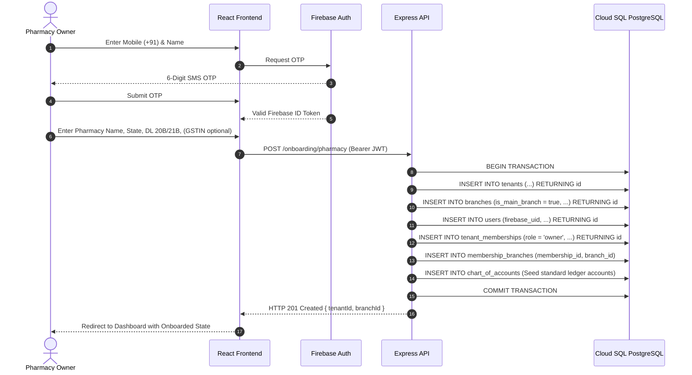
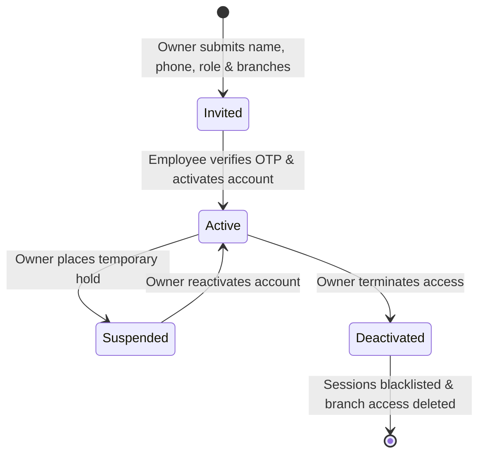
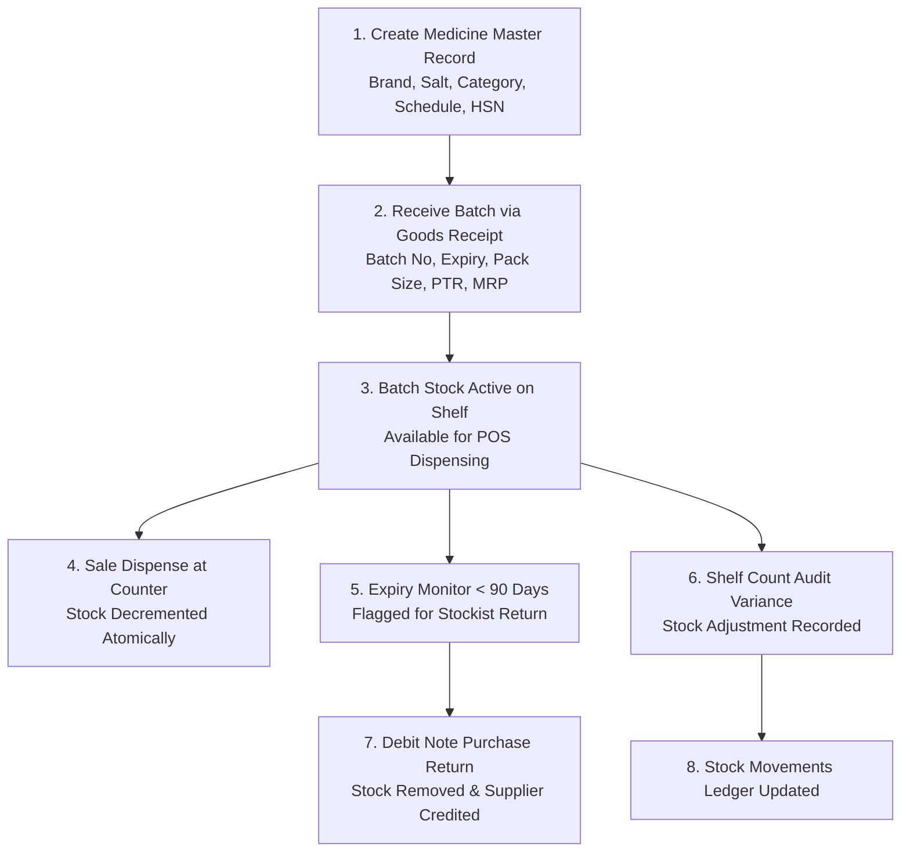
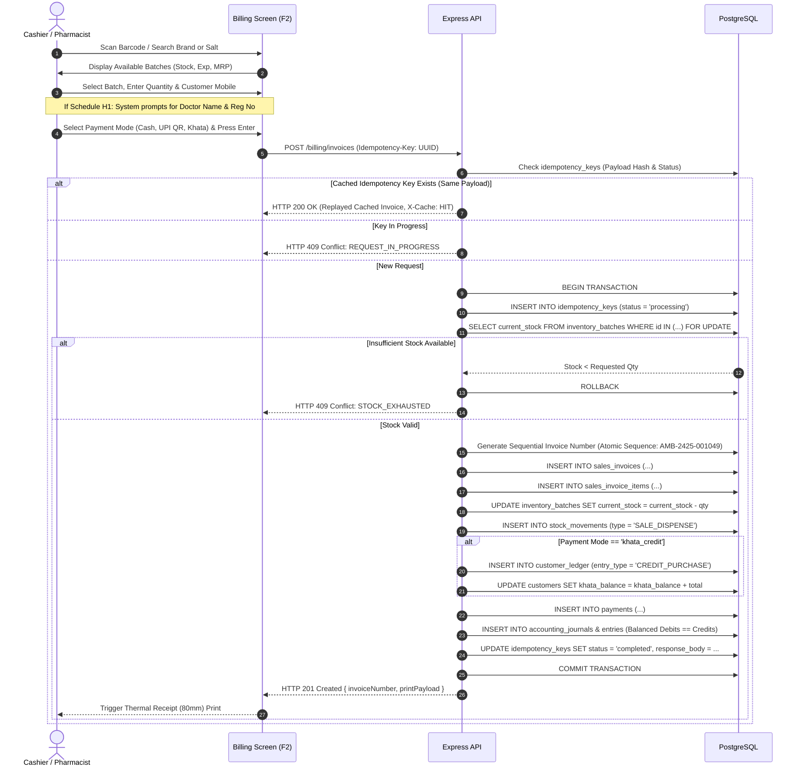
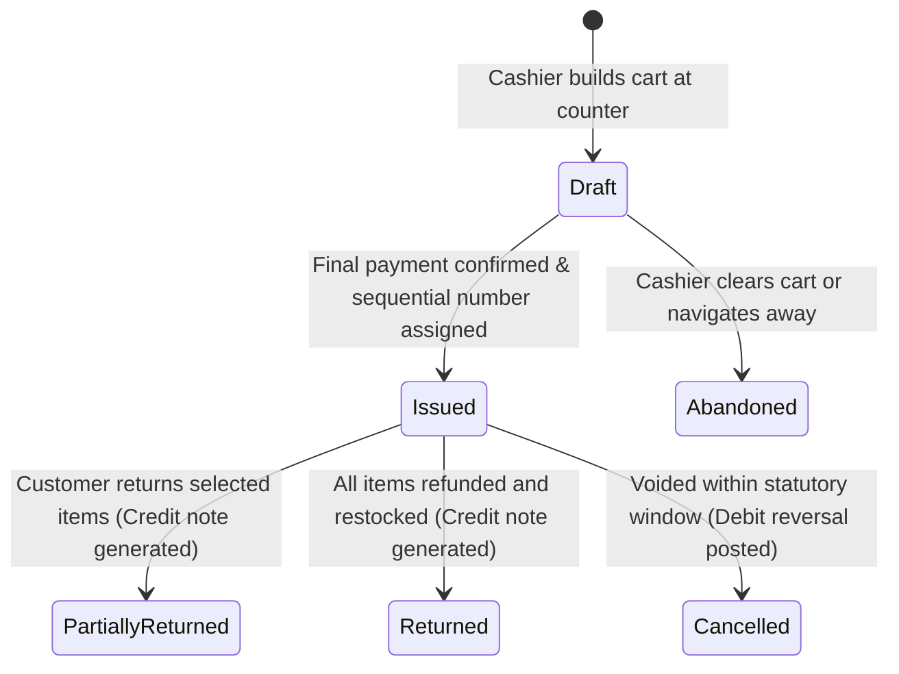
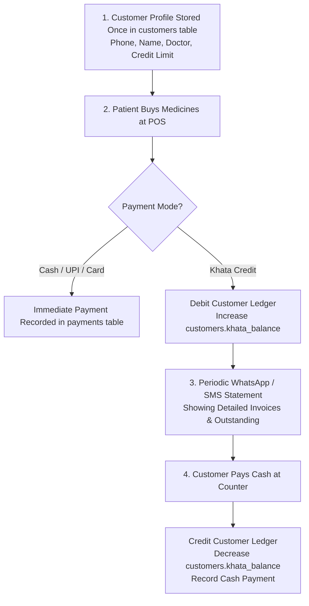

# PharmaDesk End-to-End Pharmacy Business Workflows

**Document Version:** 1.0.0 (Implementation Blueprint)  
**Scope:** Core Operational Lifecycles & Transactional Sequences  
**Standard:** Event-Driven State Machines with ACID Transaction Boundaries  

---

## 1. Pharmacy Onboarding Workflow

The onboarding workflow guides a pharmacy owner from initial phone verification to their first point-of-sale dispense.

---

## 2. Employee Lifecycle Workflow

The employee lifecycle manages hiring, branch assignment, daily counter authorization, and immediate revocation.

1. **Invitation:** Owner dispatches `POST /employees/invite` specifying phone, role, and branch IDs. An invitation row is recorded with a 72-hour expiration token.
2. **Acceptance:** Employee receives SMS link, logs in via phone OTP, and verifies their State Pharmacy Council registration number if assigned the `PHARMACIST` role.
3. **Branch Assignment:** Mappings are committed into `membership_branches`.
4. **Session Termination / Deactivation:** When an employee leaves, `DELETE FROM membership_branches` and `UPDATE tenant_memberships SET status = 'deactivated'` occur atomically. The server purges any cached tokens, instantly denying ongoing API requests.

---

## 3. Medicine & Batch Inventory Workflow

- **Safety Check:** The database trigger `trg_check_inventory_stock` blocks any transaction that would produce `current_stock < 0`.
- **No Silent Clamping:** Application code is strictly forbidden from using `GREATEST(0, stock - qty)`. Insufficient stock must raise an explicit `409 Conflict` error.

### 3.1 Stock Reconciliation Equation & Variance Auditing
Every unit change in physical inventory must be mathematically verifiable through an immutable audit trail:

$$\text{Current Batch Stock} \equiv \sum_{\text{all movements}} \text{quantity\_delta}$$

#### Physical Count Discrepancy Reconciliation
When an inventory count reveals a variance between physical shelf stock and the system record:
1. Staff records a physical audit count via `POST /inventory/adjustments`.
2. The transaction:
   - Inserts a record in `stock_adjustments` capturing `system_stock`, `counted_stock`, `variance = counted_stock - system_stock`, `reason`, and `authorized_by`.
   - Inserts an immutable row in `stock_movements` with `movement_type = 'AUDIT_ADJUSTMENT'`, `quantity_delta = variance`, and `reference_type = 'stock_adjustments'`.
   - Updates `inventory_batches.current_stock = counted_stock`.
   - If negative variance (shrinkage/theft), posts an accounting journal:
     - **Debit:** Stock Shrinkage Expense (`6050`)
     - **Credit:** Inventory Asset (`1200`)
3. **No Historical Erasure:** The database strictly prohibits updating or deleting previous movement rows. Stock adjustments correct current balances transparently without rewriting historical audit records.

---

## 4. Retail POS Billing Workflow (Concurrent Counter Dispensing)

This is the highest-velocity transaction in a retail medical store.

### 4.1 Invoice State Machine & Lifecycle
Retail invoices progress through strict statutory lifecycle states:

1. **Draft:** Uncommitted cart existing purely in frontend React state. Consumes zero database sequences or batch locks.
2. **Issued:** Permanently committed tax invoice. Numbers are generated server-side using a branch sequence (`AMB-2425-001049`). Frontend counters are never used. Figures are protected by `trg_protect_sales_invoices`.
3. **Partially Returned / Returned:** Accompanied by statutory Credit Notes (`sales_returns`), restocked items logged in `stock_movements`, and refund payments or Khata credits posted.
4. **Cancelled:** Allowed only under strict manager override before end-of-day register closure, accompanied by a full audit log and reversing journal entries.

### 4.2 Idempotency & Duplicate Prevention Protocol
All mutating financial endpoints require an `Idempotency-Key: <UUIDv4>` header.
* **Payload Hashing:** The backend calculates `SHA-256(canonicalJson(req.body))`.
* **Same Key + Same Hash:** If the previous request succeeded, the server replays the cached 200/201 response directly from `idempotency_keys.response_body` with header `X-Cache: HIT`. No duplicate inventory deductions or Khata charges can occur.
* **Same Key + Different Hash:** If a client reuses an idempotency key with different line items or prices, the server immediately rejects the request with `422 Unprocessable Entity: IDEMPOTENCY_KEY_REUSED_WITH_DIFFERENT_PAYLOAD`.
* **In-Flight Duplicate:** If Counter 1 double-clicks rapidly, the second request encounters `status = 'processing'` and returns `409 Conflict: REQUEST_IN_PROGRESS`.

---

## 5. Customer & Khata Credit Ledger Workflow

---

## 6. Supplier Procurement & Goods Receipt Workflow

1. **Purchase Order Creation:** The pharmacist creates a PO (`purchase_orders`) for a stockist specifying medicines and pack quantities.
2. **Delivery & Inward Inspection:** Goods arrive with a physical tax invoice from the stockist.
3. **Goods Receipt Entry (`POST /purchases/goods-receipts`):**
   - The user records invoice number, invoice date, batch numbers, expiry dates, pack sizes, PTR, and MRP.
   - Within an atomic transaction:
     - The batches are inserted or incremented in `inventory_batches`.
     - Inward ledger rows are recorded in `stock_movements`.
     - The supplier's accounts payable balance is credited in `supplier_ledger`.
     - A double-entry accounting journal posts:
       - **Debit:** Inventory Asset (`1200`)
       - **Debit:** Input Tax Credit CGST/SGST (`1310`, `1320`)
       - **Credit:** Accounts Payable Stockist (`2010`)
4. **Supplier Settlement:** When the pharmacy settles the distributor's bill via NEFT/Cheque/Cash, a debit entry is posted to `supplier_ledger` and `accounts_payable`.

---

## 7. Financial & Statutory Report Calculation Matrix

To prevent misleading or fabricated metrics, report formulas are defined with exact database table dependencies and sound accounting principles:

### 7.1 Core Accounting Metric Definitions
* **Gross Billing Value:** Total MRP printed on customer receipts:
  $$\text{Gross Billing Value} = \sum (\text{quantity} \times \text{mrp})$$
* **Net Sales Revenue (Turnover):** Tax-exclusive revenue earned after discounts:
  $$\text{Net Revenue} = \sum \text{sales\_invoices.taxable\_amount}$$
* **Cost of Goods Sold (COGS):** Landed purchase cost of medicines actually dispensed:
  $$\text{COGS} = \sum (\text{sales\_invoice\_items.quantity} \times \text{sales\_invoice\_items.ptr})$$
* **Gross Profit:** Net sales revenue minus wholesale cost of dispensed goods:
  $$\text{Gross Profit} = \text{Net Sales Revenue} - \text{COGS}$$
* **Net Operating Profit:**
  $$\text{Net Operating Profit} = \text{Gross Profit} - \sum \text{expenses.amount}$$
  *(Note: Simply subtracting expenses directly from gross sales without accounting for COGS and GST liability is fundamentally flawed and strictly prohibited in PharmaDesk analytics).*

### 7.2 Database Query Dependency Matrix

| Report Name | Definition / Exact Calculation Formula | Source Tables & Criteria |
| :--- | :--- | :--- |
| **Today's Gross Sales** | $\sum (\text{grand\_total}) - \sum (\text{round\_off})$ | `sales_invoices WHERE status = 'completed' AND DATE(created_at AT TIME ZONE 'Asia/Kolkata') = CURRENT_DATE` |
| **Gross Margin / Profit** | $\sum (\text{taxable\_value} - (\text{quantity} \times \text{ptr}))$ | `sales_invoice_items` joined to `sales_invoices` for given date range. |
| **Net Operational Profit** | $\text{Gross Profit} - \sum (\text{expenses.amount})$ | `sales_invoice_items` profit minus `expenses` table for same accounting period. |
| **Inventory Stock Valuation** | $\sum (\text{current\_stock} \times \text{ptr})$ | `inventory_batches WHERE current_stock > 0`. Shows total capital tied up in shelf inventory. |
| **Expiry Loss Potential** | $\sum (\text{current\_stock} \times \text{purchase\_cost})$ | `inventory_batches WHERE expiry_date \le \text{CURRENT\_DATE} + \text{INTERVAL '90 days'}`. |
| **Fast-Moving Formulations** | Ranked by $\sum (\text{sales\_invoice\_items.quantity})$ DESC | `sales_invoice_items` grouped by `medicine_id` over rolling 30 days. |
| **GSTR-1 Tax Summary** | Grouped by `hsn_code` and `gst_slab`: $\sum \text{taxable\_value}$, $\sum \text{cgst}$, $\sum \text{sgst}$ | `sales_invoice_items` for active tax month. |
| **Customer Khata Receivables** | $\sum (\text{khata\_balance})$ | `customers WHERE khata_balance > 0`. Reconciled against `customer_ledger`. |
| **Supplier Payables** | $\sum (\text{outstanding\_balance})$ | `suppliers WHERE outstanding_balance > 0`. Reconciled against `supplier_ledger`. |
