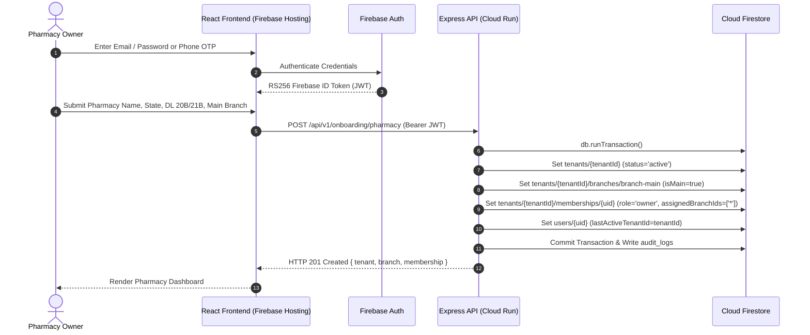
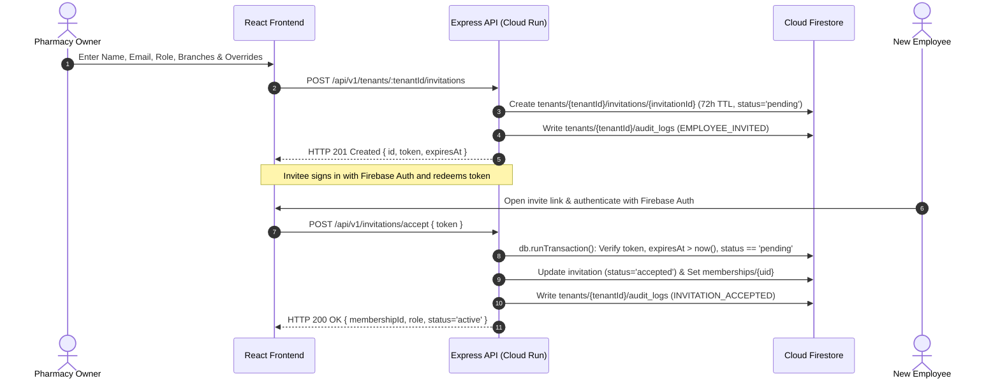
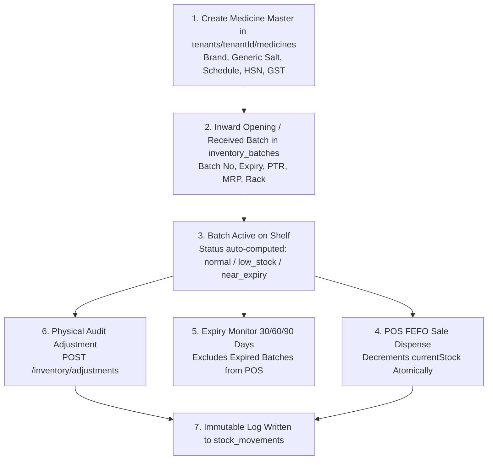
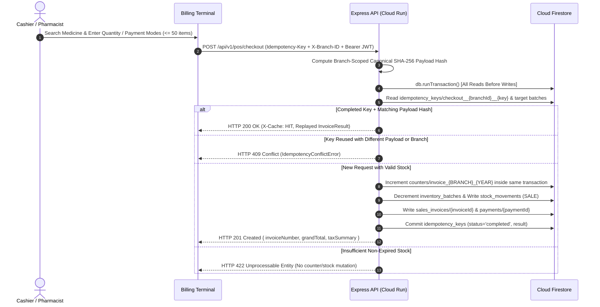

# PharmaDesk End-to-End Pharmacy Business Workflows

**Document Version:** 5.0.0 (Firebase-Standardized Operational Workflows — Phase 10 Included)  
**Scope:** Core Operational Lifecycles & Cloud Firestore ACID Transaction Sequences  
**Standard:** Event-Driven State Machines with `db.runTransaction` Atomicity

---

## 1. Pharmacy Onboarding Workflow (Phase 3)

The onboarding workflow guides a pharmacy owner from Firebase Authentication sign-in to an initialized tenant workspace in Cloud Firestore.

---

## 2. Employee Lifecycle & Staff RBAC Workflow (Phase 4)

The employee lifecycle manages invitations, branch assignment, permission overrides, and immediate session termination backed by Cloud Firestore.

### 2.1 Invitation States
- **`pending`**: Valid for 72 hours (`expiresAt`). Can be resent (`/resend`) or cancelled (`/cancel`).
- **`accepted`**: Token redeemed; token invalidated to prevent replay attacks; membership set to `active`.
- **`expired` / `cancelled` / `revoked`**: Cannot be redeemed (`HTTP 400`/`410`).

### 2.2 Immediate Access Revocation Workflow
1. Owner calls `PATCH /api/v1/tenants/:tenantId/employees/:userId/status` with `{ "status": "deactivated" }`.
2. Firestore `tenants/{tenantId}/memberships/{userId}` is updated to `status: 'deactivated'` and logged in `audit_logs`.
3. Because `tenantAuthorizationMiddleware` reads live membership status on every API call, the deactivated employee receives an immediate **HTTP 403 Forbidden** (`ERR_EMPLOYEE_DEACTIVATED`) on their very next request.

---

## 3. Medicine & Batch Inventory Workflow (Phase 5)

- **Non-Negative Stock Invariant:** `InventoryService.adjustStock` and `BillingTransactionService.createSalesInvoice` reject any operation that would leave `currentStock < 0` with `HTTP 422 InsufficientStockError`. Silent clamping (`Math.max(0, stock - qty)`) is strictly forbidden.
- **Audit Immutability:** Every stock change appends an immutable document to `tenants/{tenantId}/stock_movements` recording `movementType`, `quantityChange`, `previousQuantity`, `newQuantity`, `performedBy`, `reason`, and `timestamp`.

---

## 4. Retail POS Billing, FEFO & Idempotent Transaction Workflow (Phase 6)

### 4.1 Automated FEFO & GST Computation
1. **FEFO Allocation & Transaction Bounds:** If `batchId` is omitted, `allocateBatchesFEFO` excludes expired batches (`isBatchExpired`) and zero-stock batches, sorts remaining batches by earliest `expiryDate` ascending, and tracks cumulative working stock across duplicate medicine/batch lines in the same cart. Checkouts are capped at `50` line items to guarantee all reads and writes stay safely inside Firestore's 500-operation transaction limit.
2. **Authoritative Pricing & GST:** Unit prices default to batch `sellingPrice` / `mrp`, GST rates come from the Medicine Master, line discounts are applied cleanly with paise rounding (`roundPaise`), and taxes split cleanly into intra-state `CGST + SGST` or inter-state `IGST` with automatic `roundOff` to the nearest rupee (`grandTotal`).
3. **Split Payments & Settlements:** Checkout supports single or multi-mode payments (`cash`, `upi`, `card`, `bank_transfer`, `khata_credit`) capped at `grandTotal`. Remaining `balanceDue` can be settled via `POST /api/v1/invoices/:invoiceId/payments` inside `db.runTransaction` with mandatory `Idempotency-Key`; overpayments (`amount > balanceDue`) are explicitly rejected with `HTTP 400 Bad Request` (never silently clamped).

### 4.2 Sales Returns & Invoice Cancellations
- **Partial / Full Returns (`POST /api/v1/invoices/:id/returns`, permission `billing.return`):** Executed atomically inside `db.runTransaction` with mandatory branch-scoped `Idempotency-Key`. Validates return quantity $\le (\text{sold} - \text{alreadyReturned})$, computes proportional per-unit refund, and updates invoice status (`partially_returned` or `returned`) and `totalRefunded`. **Expired or `damaged: true` returned items never increment sellable batch stock**—they are quarantined with `restocked: false`, `nonRestockReason`, and a zero-delta `EXPIRY` or `DAMAGE` audit movement; only non-expired undamaged items restock `currentStock` via `SALE_RETURN`.
- **Invoice Cancellation (`POST /api/v1/invoices/:id/cancel`, permission `billing.cancel` — Owner only):** Executed atomically inside `db.runTransaction` (supporting optional `Idempotency-Key`), prevents duplicate cancellation (`400`), reverses only net unreturned non-expired stock with a dedicated **`INVOICE_CANCEL_REVERSAL`** movement (`referenceType: 'invoice_cancellation'`), preserves the immutable invoice document with `status: 'cancelled'`, and records `refundStatus` (`'refund_pending'` if `amountPaid > 0`, else `'not_applicable'`) alongside `refundAmount`.

---

## 5. Customer Directory & Khata Credit Ledger Workflow (Phase 7)

### 5.1 Customer Onboarding & Duplicate Phone Protection
- Customer profiles reside in `tenants/{tenantId}/customers/{customerId}` with Indian E.164 normalization (`+91XXXXXXXXXX`).
- Duplicate active mobile numbers return `HTTP 409 Conflict` by default; legitimate family or clinic shared accounts may opt in explicitly via `confirmSharedPhone: true`.
- Optional carry-forward `openingBalance` writes an initial `OPENING_BALANCE` entry into `tenants/{tenantId}/customers/{customerId}/ledger/{entryId}`.

### 5.2 POS Khata Credit Billing, Advance Consumption & Credit Override
1. POS checkouts containing `khata_credit` (full or split tender) require a linked `customerId` with `status === 'ACTIVE'`, `creditEnabled === true`, and `!isArchived`.
2. Inside the single checkout `db.runTransaction`, advance credit (`advanceBalance > 0`) is automatically applied before adding remaining financed due to `currentOutstandingBalance` and appending `CREDIT_PURCHASE` to the customer's `ledger` subcollection.
3. If `projectedOutstanding > creditLimit`, checkout rejects with `400 Bad Request` unless the caller holds `customers.credit_override` (`owner`), passes `overrideCreditLimit: true` and an explicit `creditOverrideReason`, and generates a `CUSTOMER_CREDIT_LIMIT_OVERRIDDEN` audit log.
4. `creditTermsDays` (`0 | 7 | 15 | 30`) computes `dueDate` on `sales_invoices/{invoiceId}` for overdue aging analysis (`0_7_days`, `8_15_days`, `16_30_days`, `over_30_days`).

### 5.3 FIFO / Specific Invoice Khata Repayment & Reversals
- **Repayment (`POST /api/v1/customers/:id/payments`):** Idempotent via branch-scoped `Idempotency-Key`; allocates collections either FIFO oldest-due-date first across open Khata invoices or to a targeted `invoiceId`, with optional `allowAdvance: true` storing excess as `advanceBalance`.
- **Returns & Cancellations:** Sales returns and owner invoice cancellations automatically post atomic `CREDIT_NOTE` ledger entries reducing `currentOutstandingBalance` (or crediting advance if excess), eliminating orphan credit balances.
- **Exports & Privacy:** CSV/PDF statements archive via Firebase Storage signed V4 URLs; WhatsApp (`wa.me`) summaries strip clinical/PHI metadata (`allergies`, `chronicConditions`, `dateOfBirth`).

---

## 6. Supplier Procurement, GRN & Accounts Payable Workflow (Phase 8)

### 6.1 Purchase Order Lifecycle (Non-Accounting Commitment)
- Purchase orders (`tenants/{tenantId}/purchaseOrders/{poId}`) compute intra-state (`CGST + SGST`) vs inter-state (`IGST`) taxes in integer paise without altering supplier payable balances.
- Lifecycle states: `DRAFT` $\rightarrow$ `PENDING_APPROVAL` $\rightarrow$ `APPROVED` $\rightarrow$ `PARTIALLY_RECEIVED` $\rightarrow$ `FULLY_RECEIVED` (or `CLOSED` / `CANCELLED`).
- Concurrent approvals execute under scoped lock/transaction guarantees (`409 Conflict` on duplicate approval). Blocked or archived suppliers are rejected; POs with received stock cannot be cancelled.

### 6.2 Goods Receipt Note (GRN) Posting & Batch Stock Integration
1. GRN posting requires `Idempotency-Key` / `X-Idempotency-Key` and executes under branch + procurement lock ordering (`po/branch` $\rightarrow$ `inventory` $\rightarrow$ `supplier`), backed by `tenants/{tenantId}/purchaseOperations`.
2. Each medicine line may split across multiple manufacturer batches (`batchNumber`, `expiryDate`, `PTR`, `MRP`, `sellingPrice`, `acceptedQuantity`, `rejectedQuantity`, `freeQuantity`). Expired batches and `mfgDate > expiryDate` are rejected; batches inside configurable warning threshold emit short-expiry warnings; rejected quantities never increment sellable stock.
3. Accepted + free units create Phase 5 `InventoryBatchRecord` entries (`purchaseReferenceId = grn.id`) and append `PURCHASE_RECEIPT` movements in `tenants/{tenantId}/stock_movements`.
4. Over-receipts require `goods_receipts.correct`. Unconsumed GRNs can be reversed cleanly via `/reverse`; GRNs whose batches have already been partially sold or invoiced with payments fail closed with `409 Conflict`.

### 6.3 Single-Liability Invoicing, FIFO Payments & Supplier Returns
- **Single-Liability Rule:** Exactly one `SupplierInvoice` may be recognized per `grnId` (`409 Conflict` if duplicated), ensuring payables are never double-counted across PO + GRN + Invoice.
- **FIFO & Explicit Payments:** `POST /api/v1/supplier-payments` allocates settlements FIFO oldest-due invoice first or to explicit invoices, supporting `allowAdvance: true` advance credits.
- **Supplier Returns:** `POST /api/v1/supplier-returns` deducts unconsumed stock via `PURCHASE_RETURN` movements and reduces supplier/invoice payable balances via credit note.

---

## 7. Double-Entry Financial Accounting & Reporting Workflows (Phase 9)

### 7.1 Automatic Source-to-Ledger Postings
- Every balanced voucher writes inside Firestore `runTransaction` verifying $\sum \text{debitPaise} == \sum \text{creditPaise}$ with zero client writes permitted:
  - **POS Checkout (Phase 6):** Debits Cash (`1100`), UPI Clearing (`1210`), Card Clearing (`1220`), Bank (`1200`), or Customer Receivable Khata (`1300`) + COGS (`5100`); credits Sales Revenue (`4100`), Output CGST/SGST/IGST (`2210`/`2220`/`2230`), Rounding (`5290`), and Inventory Asset (`1400`).
  - **Khata Collections & Adjustments (Phase 7):** Debits Cash/Bank/UPI/Card and credits AR Control (`1300`) or Customer Advances (`2150`).
  - **Procurement & Payables (Phase 8):** GRNs debit Inventory (`1400`) + Input GST ITC (`1510`/`1520`/`1530`) and credit `2110` GRN Unbilled Clearing (which clears cleanly into `2100` Accounts Payable on GRN-linked Supplier Invoice recognition, preventing double payables). Supplier payments debit `2100`/`1350`; supplier returns debit `2100` and credit Inventory (`1400`) + Input ITC reversals.

### 7.2 Operating Expenses, Period Locks, Bank Matching & Discrepancy Checks
- **Operating Expenses:** Pharmacists may submit expenses (`SUBMITTED` — no GL posting). Owner approval creates balanced recognition (`EXPENSE_ACCRUAL` to `2300` or direct payment `EXPENSE_PAYMENT`). Unpaid approved bills settle via `/pay` and reverse cleanly via `/reverse`.
- **Bank Reconciliation:** Stores manually import CSV/JSON statement lines exported from netbanking and match them against posted bank journals. Live bank API feeds are not connected.
- **Fiscal Period Locks & Backfill:** Monthly Indian FY (`Apr–Mar`) periods enforce backdated posting locks when `CLOSED` (`reopen` requires Owner + audit reason). GL vs subledger reconciliation continuously checks GL `1300`, `2100`, and `1400` against Khata, Supplier payables, and batch PTR valuations.
- **Financial Reports:** Trial Balance, Profit & Loss, Branch P&L, Balance Sheet (`Assets === Liabilities + Equity`), Cash Flow, Cash/Bank Books, General Ledger, Expense Summary, and internal GST Output vs ITC register (explicitly carrying a CA verification disclaimer — not direct GSTN portal filing).

---

## 8. Multi-Branch Operations & Inter-Branch Stock Transfer Workflow (Phase 10)
1. **Branch Lifecycle & Workspace Isolation:** Every branch maintains an explicit status (`ACTIVE` | `INACTIVE` | `SUSPENDED` | `CLOSED`) and `transferPolicy`. When suspended, inactivated, or closed, `requireActiveBranchMiddleware` blocks mutating POS checkout, inventory adjustments, procurement postings, and expenses while keeping historical reports readable.
2. **Controlled Branch Closure:** `GET /api/v1/branches/:branchId/closure-check` verifies zero remaining stock, zero pending transfers, zero open POs/draft GRNs, and settled customer/supplier/expense balances before `POST .../close` permanently marks a branch `CLOSED`.
3. **Two-Phase Inter-Branch Transfer & GL Accounting:**
   - **Create / Submit / Approve:** Only non-expired, available source batches may be transferred. Approval follows branch thresholds and prohibits self-approval when `allowSelfApproval === false`.
   - **Dispatch (`STOCK_TRANSFER_OUT`):** Uses deadlock-free sorted branch locks and idempotent `branchOperations`; decrements source batch `currentStock`, prints transfer challan, and posts `Dr 1450 Stock in Transit` / `Cr 1400 Inventory` with zero revenue, COGS, or GST.
   - **Receive (`STOCK_TRANSFER_IN`) & Reconcile:** Destination-authorized staff record accepted, damaged, and missing units (`accepted + damaged + missing <= pendingDispatched`, mandatory discrepancy reason). Accepted units create/update destination batches preserving `batchNumber`, `expiryDate`, `PTR`, and `MRP`, clearing `1450` into destination `1400` and posting transit shrinkage to `5280 EXP_SHRINKAGE`.
4. **Consolidated Reporting:** Chain-wide Consolidated Overview explicitly separates Branch Totals, Inter-Branch Eliminations (`1450` Stock in Transit, zero internal sales), and Net Consolidated Financials.
