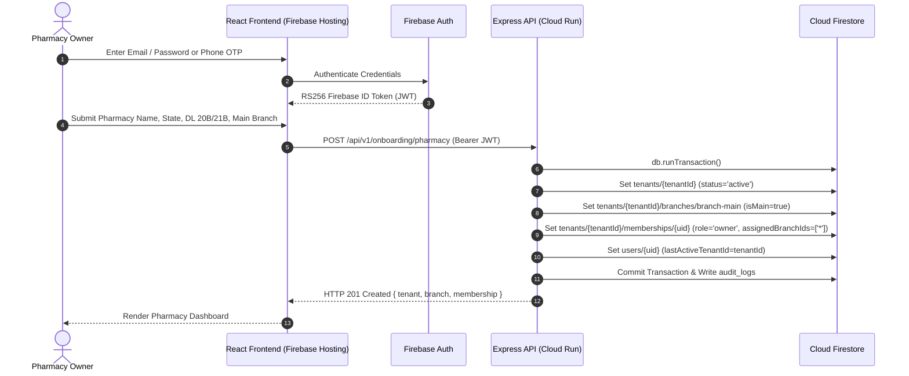
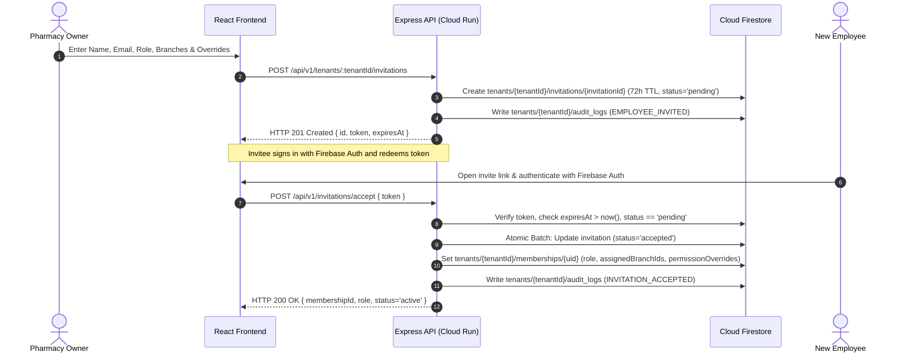
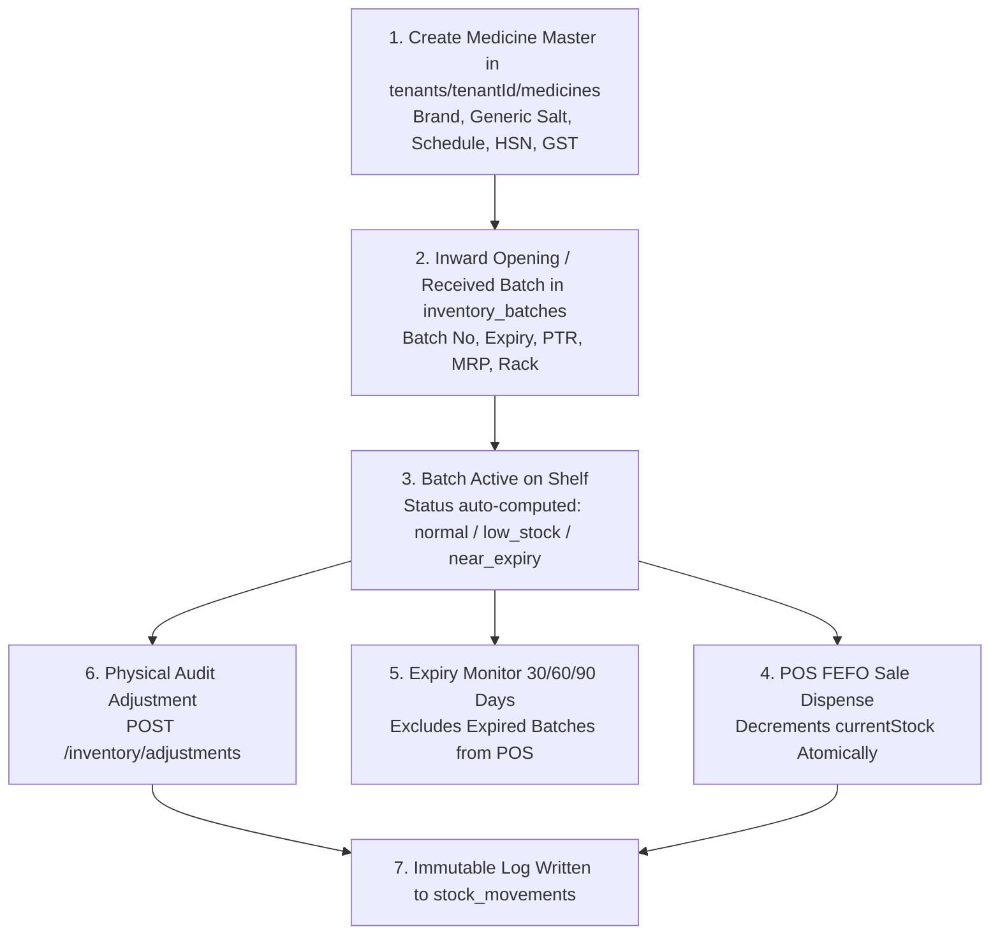
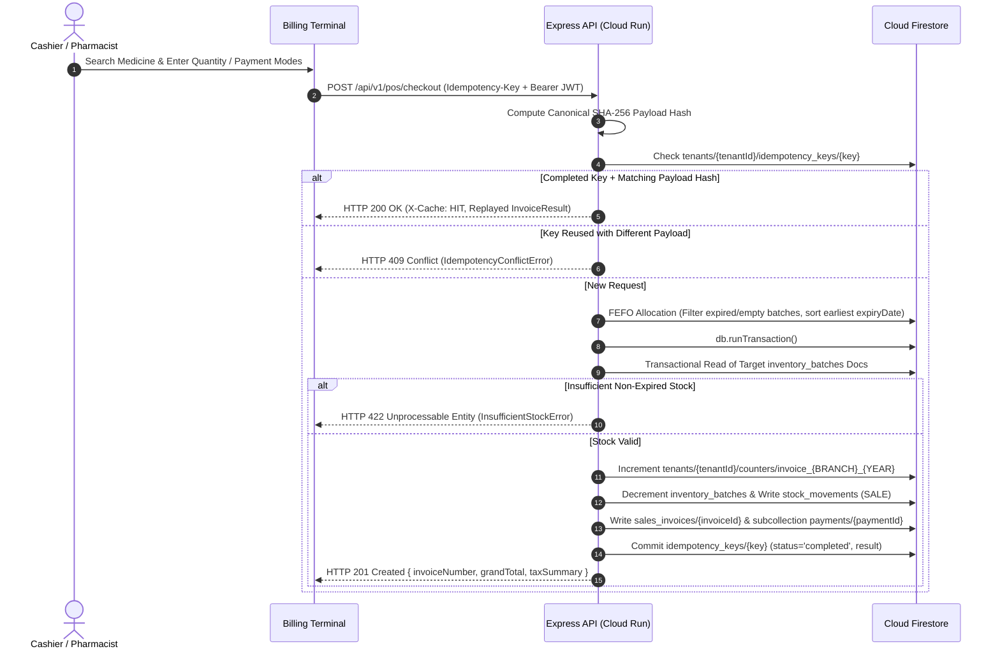

# PharmaDesk End-to-End Pharmacy Business Workflows

**Document Version:** 3.0.0 (Firebase-Standardized Operational Workflows)  
**Scope:** Core Operational Lifecycles & Cloud Firestore ACID Transaction Sequences  
**Standard:** Event-Driven State Machines with `db.runTransaction` Atomicity

---

## 1. Pharmacy Onboarding Workflow (Phase 3)

The onboarding workflow guides a pharmacy owner from Firebase Authentication sign-in to an initialized tenant workspace in Cloud Firestore.

---

## 2. Employee Lifecycle & Staff RBAC Workflow (Phase 4)

The employee lifecycle manages invitations, branch assignment, permission overrides, and immediate session termination backed by Cloud Firestore.

### 2.1 Invitation States
- **`pending`**: Valid for 72 hours (`expiresAt`). Can be resent (`/resend`) or cancelled (`/cancel`).
- **`accepted`**: Token redeemed; token invalidated to prevent replay attacks; membership set to `active`.
- **`expired` / `cancelled` / `revoked`**: Cannot be redeemed (`HTTP 400`/`410`).

### 2.2 Immediate Access Revocation Workflow
1. Owner calls `PATCH /api/v1/tenants/:tenantId/employees/:userId/status` with `{ "status": "deactivated" }`.
2. Firestore `tenants/{tenantId}/memberships/{userId}` is updated to `status: 'deactivated'` and logged in `audit_logs`.
3. Because `tenantAuthorizationMiddleware` reads live membership status on every API call, the deactivated employee receives an immediate **HTTP 403 Forbidden** (`ERR_EMPLOYEE_DEACTIVATED`) on their very next request.

---

## 3. Medicine & Batch Inventory Workflow (Phase 5)

- **Non-Negative Stock Invariant:** `InventoryService.adjustStock` and `BillingTransactionService.createSalesInvoice` reject any operation that would leave `currentStock < 0` with `HTTP 422 InsufficientStockError`. Silent clamping (`Math.max(0, stock - qty)`) is strictly forbidden.
- **Audit Immutability:** Every stock change appends an immutable document to `tenants/{tenantId}/stock_movements` recording `movementType`, `quantityChange`, `previousQuantity`, `newQuantity`, `performedBy`, `reason`, and `timestamp`.

---

## 4. Retail POS Billing, FEFO & Idempotent Transaction Workflow (Phase 6)

### 4.1 Automated FEFO & GST Computation
1. **FEFO Allocation:** If `batchId` is omitted, `allocateBatchesFEFO` excludes expired batches (`isBatchExpired`) and zero-stock batches, sorts remaining batches by earliest `expiryDate` ascending, and splits the requested quantity seamlessly across batches when needed.
2. **Authoritative Pricing & GST:** Unit prices default to batch `sellingPrice` / `mrp`, GST rates come from the Medicine Master, line discounts are applied cleanly with paise rounding (`roundPaise`), and taxes split cleanly into intra-state `CGST + SGST` or inter-state `IGST` with automatic `roundOff` to the nearest rupee (`grandTotal`).
3. **Split Payments & Settlements:** Checkout supports single or multi-mode payments (`cash`, `upi`, `card`, `bank_transfer`, `khata_credit`). Remaining `balanceDue` can be settled later via `POST /api/v1/invoices/:invoiceId/payments`.

### 4.2 Sales Returns & Invoice Cancellations
- **Partial / Full Returns (`POST /api/v1/invoices/:id/returns`, permission `billing.return`):** Validates return quantity $\le (\text{sold} - \text{alreadyReturned})$, computes proportional per-unit refund, optionally restocks units (`SALE_RETURN` movement), transitions invoice status to `partially_returned` or `returned`, and logs an audit entry.
- **Invoice Cancellation (`POST /api/v1/invoices/:id/cancel`, permission `billing.cancel` — Owner only):** Reverses unreturned stock (`MANUAL_ADJUSTMENT` restock), marks invoice `cancelled` with `cancellationReason` and `cancelledBy`, and commits an immutable audit trail entry.

---

## 5. Planned Phase 7–9 Workflows (Customers, Procurement & Accounting)

### 5.1 Customer Khata Credit Ledger *(Planned Phase 7)*
- Customer records live in `tenants/{tenantId}/customers` paired with an append-only `customer_ledger` subcollection (`CREDIT_PURCHASE`, `CASH_PAYMENT`, `CREDIT_NOTE`).
- Billing on `khata_credit` debits customer Khata atomically; cash/UPI repayments credit the ledger.

### 5.2 Supplier Procurement & Goods Receipts *(Planned Phase 8)*
- Purchase orders (`purchase_orders`) and distributor tax invoice receipts (`goods_receipts`) create or increment `inventory_batches`, append `PURCHASE_RECEIPT` records to `stock_movements`, and credit `supplier_ledger`.

### 5.3 Double-Entry Financial Accounting & Reports *(Planned Phase 9)*
- Financial events post balanced entries (`accounting_journals`) enforcing $\sum \text{Debits} == \sum \text{Credits}$ inside Firestore transactions:
  $$\text{Net Revenue} = \sum \text{sales\_invoices.taxableAmount}$$
  $$\text{COGS} = \sum (\text{item.quantity} \times \text{item.ptr})$$
  $$\text{Gross Profit} = \text{Net Revenue} - \text{COGS}$$
  $$\text{Net Operating Profit} = \text{Gross Profit} - \sum \text{expenses.amount}$$
