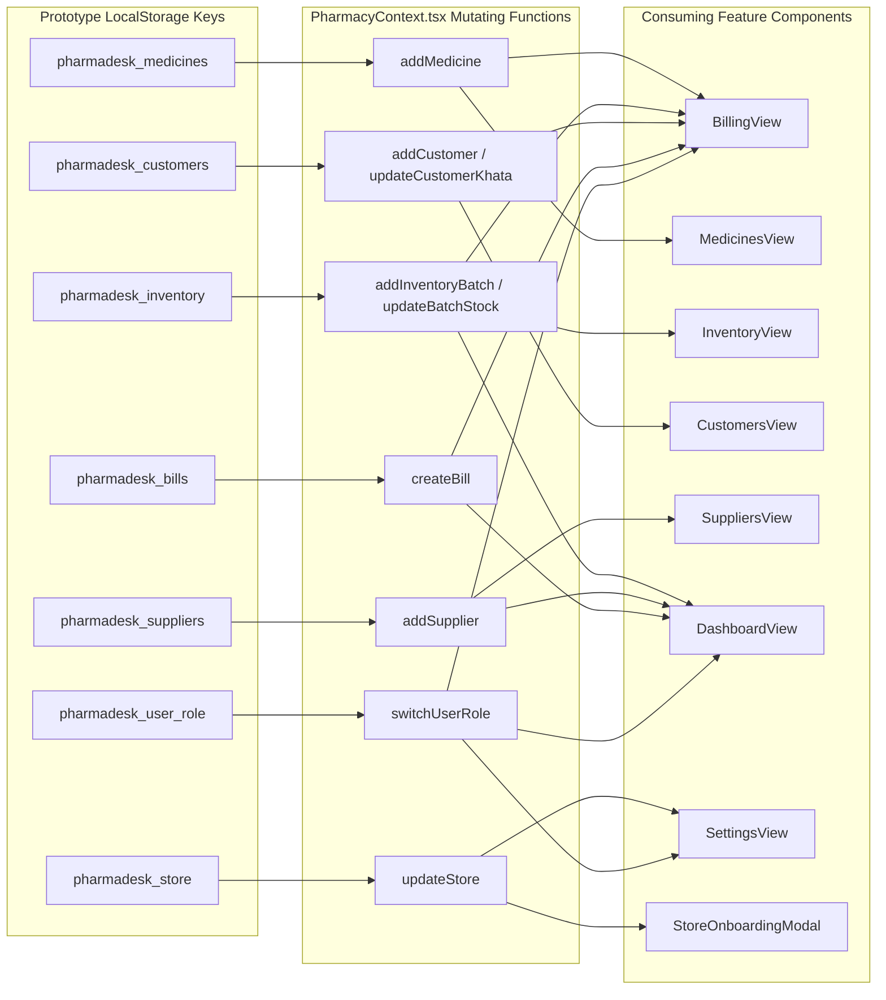

# PharmaDesk Prototype-to-Cloud Migration Strategy

**Document Version:** 2.0.0 (Hardened 7-Stage Migration Blueprint)  
**Scope:** Transition from Prototype `localStorage` & In-Memory State to Cloud SQL PostgreSQL  
**Principle:** Zero Disruption to Working POS Workflows & Zero Silent Data Loss  

---

## 1. Complete Inventory of Current Prototype State

### 1.1 Storage Keys & Component Dependency Graph



### 1.2 Mutating Functions & Target Backend Endpoints

| Prototype Context Function | Current Behavior | Target REST API Endpoint | Target PostgreSQL Table |
| :--- | :--- | :--- | :--- |
| `updateStore(data)` | Overwrites `pharmadesk_store` in localStorage | `PATCH /api/v1/settings/store` | `tenants`, `branches` |
| `addMedicine(med)` | Prepends to `medicines` array in state/localStorage | `POST /api/v1/medicines` | `medicine_master` |
| `addInventoryBatch(batch)` | Appends to `inventory` array with computed status | `POST /api/v1/purchases/goods-receipts` | `inventory_batches`, `stock_movements` |
| `updateBatchStock(id, qty)`| Updates batch count in `inventory` array | `POST /api/v1/inventory/batches/adjust` | `inventory_batches`, `stock_movements`, `stock_adjustments` |
| `addCustomer(customer)` | Appends to `customers` array | `POST /api/v1/customers` | `customers` |
| `updateCustomerKhata(id, val)`| Adds delta to customer balance in array | `POST /api/v1/customers/:id/payments` | `customers`, `customer_ledger`, `payments` |
| `addSupplier(supplier)` | Appends to `suppliers` array | `POST /api/v1/suppliers` | `suppliers` |
| `createBill(billData)` | Deducts inventory, updates Khata, appends to bills | `POST /api/v1/billing/invoices` | `sales_invoices`, `sales_invoice_items`, `inventory_batches`, `stock_movements`, `payments` |
| `switchUserRole(role)` | Toggles mock role string in localStorage | Replaced by Firebase JWT Auth | `tenant_memberships`, `membership_branches` |

---

## 2. The 7-Stage Migration Architecture

```
  STAGE 1            STAGE 2            STAGE 3            STAGE 4            STAGE 5            STAGE 6            STAGE 7
+------------+     +------------+     +------------+     +------------+     +------------+     +------------+     +------------+
| Separate   |     | Define API |     | Implement  |     | Firebase   |     | Replace    |     | Full       |     | Remove     |
| UI State   | ==> | Client &   | ==> | Backend &  | ==> | Auth &     | ==> | Local      | ==> | Financial  | ==> | Prototype  |
| from Data  |     | Query Hooks|     | PostgreSQL |     | Membership |     | Operations |     | Validation |     | Storage    |
+------------+     +------------+     +------------+     +------------+     +------------+     +------------+     +------------+
```

### Stage 1: Separate UI State from Business State
- Isolate harmless UI preferences (sidebar collapse, invoice preview mode, density) from business data.
- UI preferences remain in `localStorage` under `pharmadesk_ui_*` keys.

### Stage 2: Define API Client & Data Access Interfaces
- Create an API client layer (`src/services/api/`) utilizing TanStack Query (React Query).
- Define typed repository interfaces that abstract whether data originates from local mock stores or the cloud API.
- Support an environment toggle: `VITE_DATA_SOURCE = 'mock' | 'cloud'`.

### Stage 3: Implement Backend & PostgreSQL Database
- Provision Google Cloud SQL PostgreSQL instance and apply the schema in `docs/database-schema.md`.
- Implement Express endpoints matching `docs/api-contracts.md` with ACID transaction boundaries.

### Stage 4: Implement Firebase Authentication & Pharmacy Memberships
- Replace the prototype role-switcher with official Firebase Authentication (Phone OTP & Email).
- On initial login, invoke `POST /auth/session-sync` to resolve database memberships and permitted branches.

### Stage 5: Replace Local Business-Data Operations with API Calls
- Progressively rewire React Context functions to invoke TanStack Query mutations (`useCreateInvoice`, `useInwardBatch`, `useSettleKhata`).
- Working frontend UI components (`BillingView`, `InventoryView`, `CustomersView`) remain visually untouched.

### Stage 6: Test Billing, Inventory & Customer Transactions
- Execute full integration tests: concurrent counter checkout, goods receipt inwarding, and Khata repayment reconciliation against the live PostgreSQL backend.

### Stage 7: Remove Obsolete Sample-Data Persistence from Production
- Transition production builds to connect exclusively to the cloud API.
- Preserve sample data files (`src/lib/sampleData.ts`) strictly in development and test environments for automated unit testing and new employee onboarding sandboxes.

---

## 3. Data Export, Validation & Rollback Protocol

### 3.1 Prototype Data Export Utility
Before switching a pilot pharmacy from mock storage to the cloud API, the user can click `"Export Store Backup JSON"` in Store Settings. This generates a standardized export envelope:
```json
{
  "version": "1.0",
  "exportedAt": "2026-11-05T09:30:00Z",
  "store": { ... },
  "medicines": [ ... ],
  "inventory": [ ... ],
  "customers": [ ... ],
  "suppliers": [ ... ],
  "bills": [ ... ]
}
```

### 3.2 Database Seeding & Inward Validation
The export is ingested by a seed script that:
1. Verifies that all batches belong to valid formulations.
2. Checks that batch quantities match shelf counts.
3. Inserts master records and inward stock movements.

### 3.3 Reversible Rollback Flag
If an unexpected network or server defect occurs during pilot testing:
1. Setting `VITE_DATA_SOURCE = 'mock'` instantly restores the client interface to the tested local prototype mode.
2. No cashier is blocked from counter dispensing during operational hours.
