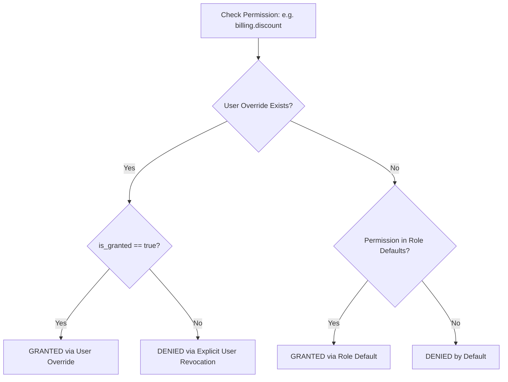

# PharmaDesk Employee Permission & RBAC Model

**Document Version:** 2.0.0 (Hardened RBAC Specification)  
**Security Standard:** Role-Based Access Control (RBAC) with User-Level Overrides  
**Enforcement Principle:** Mandatory Server-Side Evaluation (Never Client-Side Only)  

---

## 1. Principles of Authorization & Platform Separation

1. **Server-Side Exclusivity:**
   Frontend checks (`canBill`, `canManageStock`) exist exclusively for presentation ergonomics (e.g. disabling buttons or hiding tabs). The backend independently authorizes every protected endpoint using the caller's database membership.
2. **Database-Authoritative Identity:**
   Firebase Authentication is responsible only for verifying raw identity credentials (passwords, phone OTPs) and issuing ID tokens. PostgreSQL is the authoritative source for tenant membership, branch assignments, role status, and custom permissions.
3. **Strict SaaS Platform Administrator Separation:**
   PharmaDesk SaaS platform administrators (DevOps, Customer Support) possess platform maintenance roles (`SUPER_ADMIN`, `SUPPORT_AGENT`). Platform administration roles **never** automatically bypass pharmacy tenant boundaries or decrypt patient health information (PHI) or customer financial Khatas. Any customer support access requires:
   - A customer-generated, time-limited Support Access Token (valid for a maximum of 60 minutes).
   - An immutable entry logged in the pharmacy's `audit_logs`.

---

## 2. Default System Roles

### 2.1 Role: OWNER (Pharmacy Administrator & License Holder)
- **Target User:** Medical store proprietor, pharmacy managing partner, or authorized director.
- **Scope:** Complete administrative and operational authority over their registered pharmacy and all branches.
- **Key Responsibilities:**
  - Manages employee profiles, state pharmacy council registration validation, and role assignments.
  - Controls store settings, Drug Licenses (Form 20B/21B), GSTIN, and printer hardware.
  - Accesses confidential financials: profit & loss reports, supplier payables ledger, and cash drawer reconciliations.
  - Authorizes inventory audit adjustments, stock write-offs, and inter-branch transfers.

### 2.2 Role: PHARMACIST (Registered Pharmacist — B.Pharm / D.Pharm)
- **Target User:** Licensed pharmacist holding valid State Pharmacy Council credentials.
- **Scope:** Clinical dispensing and inventory operations at assigned branches.
- **Key Responsibilities:**
  - Full dispensing rights on retail POS.
  - Mandatory verification of doctor prescriptions for **Schedule H, Schedule H1, and Schedule X** controlled drugs.
  - Maintenance of the Master Medicine directory (salt composition, contraindications, dosage forms).
  - Inward verification of incoming stock batches from distributors (PTR/MRP verification).
  - Physical inventory adjustments and near-expiry returns.

### 2.3 Role: CASHIER (Billing Counter Operator)
- **Target User:** Counter billing clerk or checkout operator.
- **Scope:** Fast point-of-sale terminal dispensing and payment collection at assigned branch.
- **Key Responsibilities:**
  - Fast billing (POS) of OTC products and prescription medications (prescribed doctor details must be validated).
  - Collection of payments via Cash, UPI, Card, and Customer Khata Credit.
  - Collection of Khata repayments and generation of cash receipts.
  - Viewing daily shift counter totals.
  - **Restrictions:** Cannot edit medicine salt compositions, view distributor purchase costs (PTR), or access store profit margins.

### 2.4 Role: HELPER (Stock Assistant & Runner)
- **Target User:** Shelf organizer, store runner, or pharmacy assistant.
- **Scope:** Physical shelf stocking and customer queue assistance.
- **Key Responsibilities:**
  - Viewing medicine rack and shelf locations (e.g., "Rack A-2", "Cold Storage").
  - Physical counting of stock for periodic inventory audits.
  - Viewing pack sizes and brand names.
  - **Restrictions:** Zero access to billing checkout, financial ledgers, customer contact details, or wholesale purchase prices.

---

## 3. Standardized Dot-Notated Permissions Matrix

| Permission Code | Description | Module | OWNER | PHARMACIST | CASHIER | HELPER |
| :--- | :--- | :--- | :---: | :---: | :---: | :---: |
| `billing.view` | View billing terminal, drafts, and queue | Billing | ✓ | ✓ | ✓ | ✗ |
| `billing.create` | Dispense medicines and issue retail tax invoices | Billing | ✓ | ✓ | ✓ | ✗ |
| `billing.schedule_h1` | Dispense controlled Schedule H1/X medicines | Billing | ✓ | ✓ | ✗* | ✗ |
| `billing.discount` | Apply custom discount above default store threshold | Billing | ✓ | ✓ | ✗ | ✗ |
| `billing.cancel` | Cancel or void an issued sales invoice | Billing | ✓ | ✗ | ✗ | ✗ |
| `billing.return` | Process patient medicine return and refund | Billing | ✓ | ✓ | ✗ | ✗ |
| `medicines.view` | View medicine formulary and salt catalog | Medicines | ✓ | ✓ | ✓ | ✓ |
| `medicines.create` | Add new medicine formulations to tenant catalog | Medicines | ✓ | ✓ | ✗ | ✗ |
| `medicines.edit` | Edit drug salts, category, and HSN codes | Medicines | ✓ | ✓ | ✗ | ✗ |
| `medicines.delete` | Deactivate medicine from master catalog | Medicines | ✓ | ✗ | ✗ | ✗ |
| `inventory.view` | View batch stock quantities and rack locations | Inventory | ✓ | ✓ | ✓ | ✓ |
| `inventory.ptr_margin` | View wholesale purchase price (PTR) and margins | Inventory | ✓ | ✓ | ✗ | ✗ |
| `inventory.inward` | Inward new batch from stockist with rates | Inventory | ✓ | ✓ | ✗ | ✗ |
| `inventory.adjust` | Perform manual physical count adjustment | Inventory | ✓ | ✓ | ✗ | ✗ |
| `inventory.transfer` | Issue or receive inter-branch stock transfer | Inventory | ✓ | ✓ | ✗ | ✗ |
| `inventory.dispose` | Record disposal/write-off of expired batches | Inventory | ✓ | ✓ | ✗ | ✗ |
| `customers.view` | View patient directory and purchase history | Customers | ✓ | ✓ | ✓ | ✗ |
| `customers.create` | Register new patient / customer | Customers | ✓ | ✓ | ✓ | ✗ |
| `customers.khata_view` | View customer Khata credit ledger | Customers | ✓ | ✓ | ✓ | ✗ |
| `customers.khata_settle`| Accept cash/UPI payment against Khata due | Customers | ✓ | ✓ | ✓ | ✗ |
| `customers.credit_limit`| Modify customer Khata credit limit | Customers | ✓ | ✗ | ✗ | ✗ |
| `customers.export` | Export patient records and phone lists | Customers | ✓ | ✗ | ✗ | ✗ |
| `suppliers.manage` | Add, edit stockist profiles and payment terms | Suppliers | ✓ | ✓ | ✗ | ✗ |
| `suppliers.payables` | View distributor outstanding balance & ledger | Suppliers | ✓ | ✗ | ✗ | ✗ |
| `purchases.create` | Create purchase order for distributors | Purchases | ✓ | ✓ | ✗ | ✗ |
| `purchases.inward` | Commit goods receipt against supplier invoice | Purchases | ✓ | ✓ | ✗ | ✗ |
| `accounts.view` | View daily counter cash drawer and register | Accounts | ✓ | ✓ | ✓ | ✗ |
| `accounts.manage` | View P&L, balance sheets, and bank ledgers | Accounts | ✓ | ✗ | ✗ | ✗ |
| `accounts.expense` | Record store operating expenses | Accounts | ✓ | ✓ | ✗ | ✗ |
| `employees.invite` | Invite new staff and assign roles/branches | Employees | ✓ | ✗ | ✗ | ✗ |
| `employees.deactivate`| Deactivate employee and revoke sessions | Employees | ✓ | ✗ | ✗ | ✗ |
| `reports.view` | View sales summaries and fast-moving analytics | Reports | ✓ | ✓ | ✓ | ✗ |
| `reports.gst` | Export GSTR-1, GSTR-3B tax data | Reports | ✓ | ✗ | ✗ | ✗ |
| `reports.schedule_h1` | Export Schedule H1 statutory register | Reports | ✓ | ✓ | ✗ | ✗ |
| `settings.manage` | Modify store licenses, GSTIN, and printer setup| Settings | ✓ | ✗ | ✗ | ✗ |
| `audit_logs.view` | Inspect security and statutory audit trail | Audit | ✓ | ✗ | ✗ | ✗ |

*\*Note on Schedule H1 Dispensing: In Indian pharmacy operations, cashiers may bill Schedule H1 drugs ONLY if a registered Pharmacist verifies the physical prescription and the doctor's registration number is validated.*

---

## 4. User-Level Overrides & Inheritance Logic

PharmaDesk supports custom operational flexibility without requiring custom roles for every pharmacy:



### Resolution SQL Implementation:
```sql
CREATE OR REPLACE FUNCTION fn_check_user_permission(
    p_tenant_id UUID,
    p_user_id UUID,
    p_permission_key VARCHAR(100)
) RETURNS BOOLEAN AS $$
DECLARE
    v_override BOOLEAN;
    v_has_role_permission BOOLEAN;
BEGIN
    -- 1. Check user-level override first
    SELECT is_granted INTO v_override
    FROM user_permission_overrides upo
    JOIN permissions p ON upo.permission_id = p.id
    WHERE upo.tenant_id = p_tenant_id
      AND upo.user_id = p_user_id
      AND p.permission_key = p_permission_key;

    IF v_override IS NOT NULL THEN
        RETURN v_override;
    END IF;

    -- 2. Fall back to role permissions
    SELECT EXISTS (
        SELECT 1
        FROM tenant_memberships tm
        JOIN roles r ON (r.tenant_id = tm.tenant_id OR r.is_system_role = true) AND r.role_key = tm.primary_role
        JOIN role_permissions rp ON rp.role_id = r.id
        JOIN permissions p ON rp.permission_id = p.id
        WHERE tm.tenant_id = p_tenant_id
          AND tm.user_id = p_user_id
          AND tm.status = 'active'
          AND p.permission_key = p_permission_key
    ) INTO v_has_role_permission;

    RETURN v_has_role_permission;
END;
$$ LANGUAGE plpgsql STABLE SECURITY DEFINER;
```

---

## 5. Employee Suspension & Session Invalidation

When an employee is deactivated by the Owner (`employees.deactivate`):
1. **Database Revocation:** `UPDATE tenant_memberships SET status = 'deactivated' WHERE id = :membershipId;`
2. **Branch Mapping Deletion:** All mappings in `membership_branches` are deleted.
3. **Session Invalidation:** The backend invalidates the user's active session token cache in memory / Redis.
4. **Immediate Boundary Enforcement:** On the employee's next API request, the authorization middleware catches `status <> 'active'`, rejects the call with HTTP 403 Forbidden, and the client redirects immediately to the sign-in screen.
