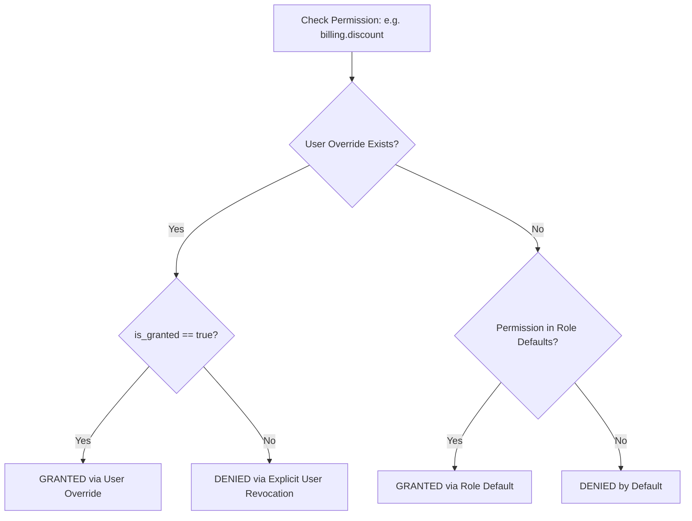

# PharmaDesk Employee Permission & RBAC Model

**Document Version:** 2.0.0 (Hardened RBAC Specification)  
**Security Standard:** Role-Based Access Control (RBAC) with User-Level Overrides  
**Enforcement Principle:** Mandatory Server-Side Evaluation (Never Client-Side Only)  

---

## 1. Principles of Authorization & Platform Separation

1. **Server-Side Exclusivity:**
   Frontend checks (`canBill`, `canManageStock`) exist exclusively for presentation ergonomics (e.g. disabling buttons or hiding tabs). The backend independently authorizes every protected endpoint using the caller's database membership.
2. **Database-Authoritative Identity:**
   Firebase Authentication is responsible only for verifying raw identity credentials (passwords, phone OTPs) and issuing ID tokens. PostgreSQL is the authoritative source for tenant membership, branch assignments, role status, and custom permissions.
3. **Strict SaaS Platform Administrator Separation:**
   PharmaDesk SaaS platform administrators (DevOps, Customer Support) possess platform maintenance roles (`SUPER_ADMIN`, `SUPPORT_AGENT`). Platform administration roles **never** automatically bypass pharmacy tenant boundaries or decrypt patient health information (PHI) or customer financial Khatas. Any customer support access requires:
   - A customer-generated, time-limited Support Access Token (valid for a maximum of 60 minutes).
   - An immutable entry logged in the pharmacy's `audit_logs`.

---

## 2. Default System Roles

### 2.1 Role: OWNER (Pharmacy Administrator & License Holder)
- **Target User:** Medical store proprietor, pharmacy managing partner, or authorized director.
- **Scope:** Complete administrative and operational authority over their registered pharmacy and all branches.
- **Key Responsibilities:**
  - Manages employee profiles, state pharmacy council registration validation, and role assignments.
  - Controls store settings, Drug Licenses (Form 20B/21B), GSTIN, and printer hardware.
  - Accesses confidential financials: profit & loss reports, supplier payables ledger, and cash drawer reconciliations.
  - Authorizes inventory audit adjustments, stock write-offs, and inter-branch transfers.

### 2.2 Role: PHARMACIST (Registered Pharmacist — B.Pharm / D.Pharm)
- **Target User:** Licensed pharmacist holding valid State Pharmacy Council credentials.
- **Scope:** Clinical dispensing and inventory operations at assigned branches.
- **Key Responsibilities:**
  - Full dispensing rights on retail POS.
  - Mandatory verification of doctor prescriptions for **Schedule H, Schedule H1, and Schedule X** controlled drugs.
  - Maintenance of the Master Medicine directory (salt composition, contraindications, dosage forms).
  - Inward verification of incoming stock batches from distributors (PTR/MRP verification).
  - Physical inventory adjustments and near-expiry returns.

### 2.3 Role: CASHIER (Billing Counter Operator)
- **Target User:** Counter billing clerk or checkout operator.
- **Scope:** Fast point-of-sale terminal dispensing and payment collection at assigned branch.
- **Key Responsibilities:**
  - Fast billing (POS) of OTC products and prescription medications (prescribed doctor details must be validated).
  - Collection of payments via Cash, UPI, Card, and Customer Khata Credit.
  - Collection of Khata repayments and generation of cash receipts.
  - Viewing daily shift counter totals.
  - **Restrictions:** Cannot edit medicine salt compositions, view distributor purchase costs (PTR), or access store profit margins.

### 2.4 Role: HELPER (Stock Assistant & Runner)
- **Target User:** Shelf organizer, store runner, or pharmacy assistant.
- **Scope:** Physical shelf stocking and customer queue assistance.
- **Key Responsibilities:**
  - Viewing medicine rack and shelf locations (e.g., "Rack A-2", "Cold Storage").
  - Physical counting of stock for periodic inventory audits.
  - Viewing pack sizes and brand names.
  - **Restrictions:** Zero access to billing checkout, financial ledgers, customer contact details, or wholesale purchase prices.

---

## 3. Standardized Dot-Notated Permissions Matrix

| Permission Code | Description | Module | OWNER | PHARMACIST | CASHIER | HELPER |
| :--- | :--- | :--- | :---: | :---: | :---: | :---: |
| `billing.view` | View billing terminal, drafts, and queue | Billing | ✓ | ✓ | ✓ | ✗ |
| `billing.create` | Dispense medicines and issue retail tax invoices | Billing | ✓ | ✓ | ✓ | ✗ |
| `billing.schedule_h1` | Dispense controlled Schedule H1/X medicines | Billing | ✓ | ✓ | ✗* | ✗ |
| `billing.discount` | Apply custom discount above default store threshold | Billing | ✓ | ✓ | ✗ | ✗ |
| `billing.cancel` | Cancel or void an issued sales invoice | Billing | ✓ | ✗ | ✗ | ✗ |
| `billing.return` | Process patient medicine return and refund | Billing | ✓ | ✓ | ✗ | ✗ |
| `medicines.view` | View medicine formulary and salt catalog | Medicines | ✓ | ✓ | ✓ | ✓ |
| `medicines.create` | Add new medicine formulations to tenant catalog | Medicines | ✓ | ✓ | ✗ | ✗ |
| `medicines.edit` | Edit drug salts, category, and HSN codes | Medicines | ✓ | ✓ | ✗ | ✗ |
| `medicines.delete` | Deactivate medicine from master catalog | Medicines | ✓ | ✗ | ✗ | ✗ |
| `inventory.view` | View batch stock quantities and rack locations | Inventory | ✓ | ✓ | ✓ | ✓ |
| `inventory.ptr_margin` | View wholesale purchase price (PTR) and margins | Inventory | ✓ | ✓ | ✗ | ✗ |
| `inventory.inward` | Inward new batch from stockist with rates | Inventory | ✓ | ✓ | ✗ | ✗ |
| `inventory.adjust` | Perform manual physical count adjustment | Inventory | ✓ | ✓ | ✗ | ✗ |
| `inventory.transfer` | Issue or receive inter-branch stock transfer | Inventory | ✓ | ✓ | ✗ | ✗ |
| `inventory.dispose` | Record disposal/write-off of expired batches | Inventory | ✓ | ✓ | ✗ | ✗ |
| `customers.view` | View patient directory and purchase history | Customers | ✓ | ✓ | ✓ | ✗ |
| `customers.create` | Register new patient / customer | Customers | ✓ | ✓ | ✓ | ✗ |
| `customers.khata_view` | View customer Khata credit ledger | Customers | ✓ | ✓ | ✓ | ✗ |
| `customers.khata_settle`| Accept cash/UPI payment against Khata due | Customers | ✓ | ✓ | ✓ | ✗ |
| `customers.credit_limit`| Modify customer Khata credit limit | Customers | ✓ | ✗ | ✗ | ✗ |
| `customers.export` | Export patient records and phone lists | Customers | ✓ | ✗ | ✗ | ✗ |
| `suppliers.manage` | Add, edit stockist profiles and payment terms | Suppliers | ✓ | ✓ | ✗ | ✗ |
| `suppliers.payables` | View distributor outstanding balance & ledger | Suppliers | ✓ | ✗ | ✗ | ✗ |
| `purchases.create` | Create purchase order for distributors | Purchases | ✓ | ✓ | ✗ | ✗ |
| `purchases.inward` | Commit goods receipt against supplier invoice | Purchases | ✓ | ✓ | ✗ | ✗ |
| `accounts.view` | View daily counter cash drawer and register | Accounts | ✓ | ✓ | ✓ | ✗ |
| `accounts.manage` | View P&L, balance sheets, and bank ledgers | Accounts | ✓ | ✗ | ✗ | ✗ |
| `accounts.expense` | Record store operating expenses | Accounts | ✓ | ✓ | ✗ | ✗ |
| `employees.invite` | Invite new staff and assign roles/branches | Employees | ✓ | ✗ | ✗ | ✗ |
| `employees.deactivate`| Deactivate employee and revoke sessions | Employees | ✓ | ✗ | ✗ | ✗ |
| `reports.view` | View sales summaries and fast-moving analytics | Reports | ✓ | ✓ | ✓ | ✗ |
| `reports.gst` | Export GSTR-1, GSTR-3B tax data | Reports | ✓ | ✗ | ✗ | ✗ |
| `reports.schedule_h1` | Export Schedule H1 statutory register | Reports | ✓ | ✓ | ✗ | ✗ |
| `settings.manage` | Modify store licenses, GSTIN, and printer setup| Settings | ✓ | ✗ | ✗ | ✗ |
| `audit_logs.view` | Inspect security and statutory audit trail | Audit | ✓ | ✗ | ✗ | ✗ |

*\*Note on Schedule H1 Dispensing: In Indian pharmacy operations, cashiers may bill Schedule H1 drugs ONLY if a registered Pharmacist verifies the physical prescription and the doctor's registration number is validated.*

### 3.1 Phase 5 Permission Aliases & Compatibility Matrix
For API backward compatibility and modular naming conventions, the authorization layer (`server/src/lib/permissions.ts`) maps semantic aliases bidirectionally:

| Core Dot Notation | Accepted Aliases | Purpose / Scope |
| :--- | :--- | :--- |
| `medicines.view` | `medicine.view` | Read catalogue formulations, salt directory |
| `medicines.create` | `medicine.create` | Add new medicine master formulations |
| `medicines.edit` | `medicine.update` | Modify brand, packaging, schedule, tax rates |
| `medicines.delete` | `medicine.archive` | Soft-archive catalogue entry |
| `inventory.inward` | `inventory.opening_stock`, `inventory.write` | Record initial batch or inward stock |
| `inventory.view` | `inventory.view_movements`, `inventory.view_expiry` | Access batch lists, movement logs, expiry reports |
| `inventory.ptr_margin`| `inventory.view_valuation` | View confidential purchase costs and valuation |

---

## 4. User-Level Overrides & Inheritance Logic

PharmaDesk supports custom operational flexibility without requiring custom roles for every pharmacy:



### Resolution Implementation (TypeScript & Cloud Firestore):
```typescript
/**
 * Evaluates effective permissions for a user given their role and custom overrides.
 *
 * Algorithm:
 * 1. Owner role always returns ['*'] (unrestricted superuser within tenant).
 * 2. Start with DEFAULT_ROLE_PERMISSIONS[role].
 * 3. Add explicit granted overrides (permissionOverrides.granted).
 * 4. Filter out explicit revoked overrides (permissionOverrides.revoked).
 * 5. Deduplicate and return final permission key list.
 */
export function resolveEffectivePermissions(
  role: UserRole,
  overrides?: { granted?: string[]; revoked?: string[] }
): string[] {
  if (role === 'owner') {
    return ['*'];
  }

  const basePermissions = DEFAULT_ROLE_PERMISSIONS[role] || [];
  const granted = (overrides?.granted || []).map(normalizePermissionKey);
  const revoked = new Set((overrides?.revoked || []).map(normalizePermissionKey));

  const effective = new Set<string>();

  for (const perm of basePermissions) {
    const normalized = normalizePermissionKey(perm);
    if (!revoked.has(normalized)) {
      effective.add(normalized);
    }
  }

  for (const perm of granted) {
    if (!revoked.has(perm)) {
      effective.add(perm);
    }
  }

  return Array.from(effective);
}
```

### Firestore Membership Document:
```json
// Path: tenants/{tenantId}/memberships/{membershipId}
{
  "id": "mem_usr123",
  "userId": "usr123",
  "email": "pharmacist@patelmedicals.in",
  "role": "pharmacist",
  "status": "active",
  "assignedBranchIds": ["branch-main", "branch-counter-2"],
  "permissionOverrides": {
    "granted": ["billing.discount"],
    "revoked": ["inventory.ptr_margin"]
  },
  "invitedBy": "owner_usr_01",
  "createdAt": "2026-03-30T10:00:00.000Z",
  "updatedAt": "2026-03-30T10:00:00.000Z"
}
```

---

## 5. Employee Suspension & Session Invalidation

When an employee is deactivated by the Owner (`employees.deactivate`):
1. **Firestore Membership Status Update:** `memberships/{membershipId}` document has `status` updated to `'deactivated'`.
2. **Immediate Access Revocation:** The server's `tenantAuthorizationMiddleware` fetches the membership document on every protected request. When `status !== 'active'`, it immediately returns HTTP 403 Forbidden with `ERR_EMPLOYEE_DEACTIVATED`.
3. **Audit Log Trail:** An immutable audit entry is committed to `tenants/{tenantId}/audit_logs` capturing the actor UID, target employee UID, timestamp, and previous/new status.
4. **No Dependence on JWT Claims:** Because authorization is evaluated against the live Firestore database membership per request, access is terminated instantaneously upon owner action.

---

## 6. Clinical Dispensing Authorization & State Council Credential Validation

Under Indian drug regulations (Drugs and Cosmetics Act, 1940 and Rules 1945), authorization to dispense prescription medications (Schedule H, H1, and X) must **never** be granted based solely on an arbitrary administrative job title or string label.

### 6.1 Multi-Point Clinical Verification Protocol
To dispense controlled or prescription medications, the backend enforces a four-point verification pipeline:

1. **State Pharmacy Council Credential Verification:**
   - The user record (`users`) must contain a valid, non-null `pharmacist_reg_number` (issued by the State Pharmacy Council, e.g., Maharashtra State Pharmacy Council).
   - The credential must be active: `pharmacist_reg_expiry >= CURRENT_DATE`. If expired, clinical dispensing permissions are suspended automatically regardless of role.
2. **Prescriber Detail Enforcement:**
   - For all Schedule H, H1, and X formulations, the sales invoice must capture:
     - `doctor_name` (Registered Medical Practitioner).
     - `doctor_reg_number` (State/National Medical Commission Registration).
   - Incomplete prescriber records trigger an HTTP 422 Unprocessable Entity error.
3. **Configurable Pharmacy Policy Validation:**
   Pharmacies can configure store-level clinical rules in `tenants.settings`:
   - `require_prescription_image_upload`: Mandates attaching a scan/photo of the prescription for Schedule H1/X.
   - `enforce_schedule_x_dual_signoff`: Requires both the counter clerk and the supervising registered pharmacist to authenticate the checkout.
   - `max_refill_days_limit`: Enforces a maximum window for repeat dispensing without a fresh prescription.
4. **Cashier Countersignature Workflow:**
   If a non-pharmacist cashier operates the terminal, any cart containing Schedule H1 or X drugs prompts a Pharmacist Sign-Off modal: an on-duty registered pharmacist must enter their secure PIN, recording `pharmacist_user_id` as the clinical dispensing authority in `sales_invoices.dispensed_by`.
