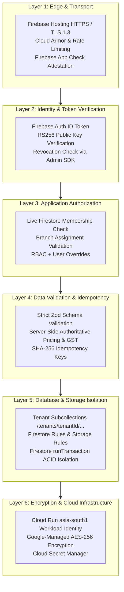

# PharmaDesk Security, Data Privacy & Backup Architecture

**Document Version:** 5.1.0 (Standardized Firebase-First Security Architecture — Phase 11 Hardening & DR Runbook)  
**Classification:** Confidential Engineering & Security Operations Document  
**Target Compliance:** DPDP Act 2023, ISO/IEC 27001 Controls, CDSCO Audit Guidelines  

---

## 1. Security Architecture & Threat Defense

PharmaDesk implements defense-in-depth across six standardized Firebase and Google Cloud layers:

---

## 2. Authentication & Authorization Controls

### 2.1 Token Verification & Session Revocation Lifecycle
1. Firebase Authentication issues RS256 asymmetric ID tokens (60-minute expiry with client SDK refresh).
2. Protected backend routes verify tokens via `adminAuth().verifyIdToken(idToken, true)`, detecting expired or revoked sessions immediately and logging auth/App Check failures with `requestId`, `method`, `path`, `ip`, and error code (never logging tokens, passwords, or credentials).
3. `POST /api/v1/auth/logout` executes server-side `adminAuth().revokeRefreshTokens(uid)` (outside test mode) and writes an `auth.logout` audit event when tenant context is supplied.
4. Deactivating or suspending an employee (`TenantService.updateMemberStatus` and `EmployeeService.updateStatus`) triggers best-effort `adminAuth().revokeRefreshTokens(targetUserId)` alongside immediate Firestore membership updates and `auth`-category audit logs.
5. When `FIREBASE_APP_CHECK_REQUIRED=true`, requests must include a valid `X-Firebase-AppCheck` token verified via `appCheck().verifyToken(...)` (failing closed with `403 Forbidden` if absent or invalid).

### 2.2 Live Firestore Membership, Branch Isolation & Escalation Prevention
The backend rejects static JWT custom claims as an authorization authority. On every protected request, `tenantAuthorizationMiddleware` reads `tenants/{tenantId}` and `tenants/{tenantId}/memberships/{userId}` directly from Cloud Firestore:
- Verifies the pharmacy tenant itself is active (`tenant.status === 'active'`, blocking suspended/cancelled tenants with HTTP `403 Forbidden`).
- Verifies `membership.status === 'active'` (deactivated/suspended employees receive immediate HTTP `403 Forbidden`).
- Enforces explicit branch-membership validation on single-record and branch lifecycle endpoints (`inventory/:batchId`, `invoices/:id/cancel|payments|returns`, `purchase-orders/:id/*`, `goods-receipts/:id/reverse`, `journal-entries/:id/reverse`, `bank-reconciliations/*`, `stock-transfers/:id/*`, `branches/:branchId/*`).
- Enforces `requireActiveBranchMiddleware` on financial, Khata, procurement, billing payment/return, accounting, and storage upload mutations so `SUSPENDED` or `CLOSED` branches cannot post new financial records while allowing historical reads.
- Masks raw employee invitation tokens after initial issuance (`***xxxxxx`), prevents non-owner managers from assigning custom `permissions`/`permissionOverrides` or unassigned branches on `POST /members`, `POST /invitations`, and `PATCH /employees/:userId/branches`, validates target branch existence via `BranchService.validateBranchesExist`, and gates `GET /members` behind `employees.view`.
- Enforces strict Zod update validation (`updateCustomerSchema.strict()`) blocking unknown mass-assignment fields (`422`) and rejecting direct tampering of computed Khata balances (`400`).

### 2.3 HTTP, CORS & Container Hardening (Phase 11)
- `NODE_ENV=production` rejects wildcard `'*'` values in `CORS_ALLOWED_ORIGINS` at startup (`validateEnv`).
- Helmet enforces `X-Frame-Options: DENY`, `Referrer-Policy: strict-origin-when-cross-origin`, and production HSTS; `/api/v1/*` operational endpoints return `Cache-Control: no-store, no-cache, must-revalidate, private`.
- Node HTTP server timeouts (`requestTimeout: 30_000`, `headersTimeout: 15_000`, `keepAliveTimeout: 65_000`) mitigate Slowloris connection exhaustion.
- Sensitive endpoints (`/auth`, `/invitations`, `/security`) enforce tighter rate-limit budgets behind configurable `TRUST_PROXY`.
- `Dockerfile` separates build vs production dependencies, drops root privileges (`USER node`), and defines a container `HEALTHCHECK` against `/api/v1/health/live`.

---

## 3. Cloud Firestore, Storage Rules & Service-Account Hygiene

### 3.1 Firestore & Storage Rules (Fail-Closed Default Deny)
- `firestore.rules`: Defaults to `allow read, write: if false`. Read access requires `isTenantActive(tenantId)` and `isActiveMember(tenantId)`, with branch-scoped reads requiring explicit non-empty `assignedBranchIds`. Phase 11 governance collections (`security_policies`, `dpdp_exports`, `dr_drills`) allow reads only for `owner`, `security.view`, or `audit.view`, while **blocking all direct client writes (`allow write: if false;`)**.
- `storage.rules`: Enforces `tenants/{tenantId}/branches/{branchId}/{category}/{fileName}` isolation, checks `isTenantActive(tenantId)`, `hasBranchAccess(tenantId, branchId)`, and `isSafeFileName(fileName)` (`^[a-zA-Z0-9._-]+$`, no `..`, 3–180 chars), restricts categories to `['invoice_pdfs', 'prescriptions', 'supplier_bills', 'product_images', 'documents']`, caps uploads under 15 MB, and enforces an explicit safe MIME allowlist (`image/jpeg`, `image/png`, `image/webp`, `application/pdf`).
- `StorageService` & `storage.routes.ts`: Generate cryptographic `crypto.randomBytes(6)` object IDs, reject path traversal and encoded separator sequences (`..`, `/`, `\`, `%`, `\0`), clamp signed URL expirations to `1–60` minutes, log all upload/download/verify events to `AuditService`, and provide `POST /api/v1/tenants/:tenantId/storage/verify-upload` to verify uploaded object magic-byte signatures (`%PDF-`, JPEG, PNG, WEBP) and reject/quarantine embedded `<svg>/<script>/<html`/`<?php` polyglots.

### 3.2 Service-Account, CI/CD & Credential Boundaries
- `firebaseAdmin.ts` initializes as a guarded singleton validating `FIREBASE_PROJECT_ID` and `FIREBASE_STORAGE_BUCKET`, rejecting partial credential pairs and **failing closed in `NODE_ENV=production`** when credentials or Cloud Run Workload Identity ADC are absent.
- Cloud Run deployments should run under a dedicated least-privilege runtime service account (`roles/datastore.user`, `roles/storage.objectAdmin`, `roles/firebaseauth.admin`, `roles/firebaseappcheck.tokenVerifier`, `roles/secretmanager.secretAccessor`) with Workload Identity Federation in CI/CD (`.github/workflows/backend-ci.yml`) and 90-day secret rotation in Cloud Secret Manager.

---

## 4. Sensitive Patient Health Data & DPDP Act 2023

1. **Access Minimization, Redaction & CSV Safety:**
   - Patient mobile numbers are masked (`+91 ******2345`) for roles lacking `customers.view_phone`; Pino logger and `AuditService` redact PHI (`allergies`, `chronicConditions`, `dateOfBirth`, `phone`), supplier bank details, and secret tokens.
   - All CSV exports use `escapeCsvCell()` to neutralize spreadsheet formula injection prefixes (`=`, `+`, `-`, `@`, `\t`, `\r`) while preserving plain signed decimals (`-125.00`).
2. **Audited Data Portability & Configurable Statutory Retention:**
   - Owners can configure tenant statutory retention windows (`PUT /api/v1/security/retention-policy`: 6–10 yrs tax invoices, 3–10 yrs prescriptions, 365–3650 days audit logs, legal hold flag) and generate SHA-256 checksummed DPDP tenant portability exports (`POST /api/v1/security/dpdp-export`) with clinical PHI redacted unless explicitly justified and audited.

---

## 5. Backup, Disaster Recovery, Monitoring & Restore Verification Runbook

- **Targets:** `DR_RPO_MINUTES=5`, `DR_RTO_MINUTES=30`, configurable `BACKUP_BUCKET_NAME` in `asia-south1`.
- **Application-Level Integrity Drills (`POST /api/v1/security/dr-drills`):** Verifies balanced double-entry journals (`debitTotalPaise === creditTotalPaise`), branch completeness, and dataset SHA-256 digests with immutable drill history in `tenants/{tenantId}/dr_drills`.
- **Cloud Backup & Restore SOP (Staging / Production GCP Runbook — Not Live-Provisioned in Container):**
  1. Enable **Cloud Firestore Point-in-Time Recovery (PITR)** (7-day retention, `asia-south1`) and schedule daily `gcloud firestore export` snapshots to a dedicated `asia-south1` GCS Coldline bucket with Object Versioning and Retention Lock enabled.
  2. For restore verification, import a snapshot or PITR timestamp into an **isolated staging Firebase project/database** (never overwrite production directly), run `POST /api/v1/security/dr-drills` and Trial Balance reconciliation, confirm zero unbalanced journals, and only switch traffic after verification.
- **Cloud Monitoring Alerting Baseline (Staging / Production):**
  - Alert on Cloud Run `5xx` error rate > 1% (5-minute window), sustained `401/403` auth failure spikes on `/api/v1/auth/*` or tenant routes, App Check verification rejection spikes, and failed Cloud Scheduler Firestore backup executions.
