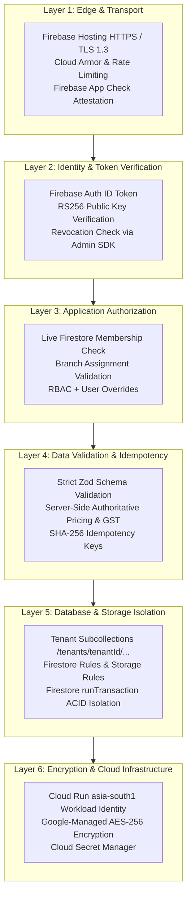

# PharmaDesk Security, Data Privacy & Backup Architecture

**Document Version:** 4.0.0 (Standardized Firebase-First Security Architecture — Phase 9 Included)  
**Classification:** Confidential Engineering & Security Operations Document  
**Target Compliance:** DPDP Act 2023, ISO/IEC 27001 Controls, CDSCO Audit Guidelines  

---

## 1. Security Architecture & Threat Defense

PharmaDesk implements defense-in-depth across six standardized Firebase and Google Cloud layers:

---

## 2. Authentication & Authorization Controls

### 2.1 Token Verification Lifecycle
1. Firebase Authentication issues RS256 asymmetric ID tokens (60-minute expiry with automatic client SDK refresh).
2. The Express backend verifies tokens using `adminAuth().verifyIdToken(idToken, true)` via Firebase Admin SDK, detecting expired or revoked sessions immediately.
3. When `FIREBASE_APP_CHECK_REQUIRED=true`, requests must include a valid `X-Firebase-AppCheck` token verified via `appCheck().verifyToken(...)`.

### 2.2 Live Firestore Membership & Branch Resolution
The backend rejects static JWT custom claims as an authorization authority. On every protected request, `tenantAuthorizationMiddleware` reads `tenants/{tenantId}` and `tenants/{tenantId}/memberships/{userId}` directly from Cloud Firestore:
- Verifies the pharmacy tenant itself is active (`tenant.status === 'active'`, blocking suspended/cancelled tenants with HTTP `403 Forbidden`).
- Verifies `membership.status === 'active'` (deactivated employees receive immediate HTTP `403 Forbidden`).
- Requires explicit `X-Branch-ID` resolution (no silent `'main'` fallback on operational routes) and validates against non-empty `membership.assignedBranchIds` for non-owners (only `owner` holds implicit/wildcard branch access; non-owners with empty `assignedBranchIds: []` or `'*'` are rejected with `403 Forbidden`).
- Computes effective permissions via `resolveEffectivePermissions(role, permissionOverrides)` while stripping/rejecting any wildcard (`'*'` or `'category.*'`) overrides for non-owner accounts.

---

## 3. Cloud Firestore, Storage Rules & Service-Account Hygiene

### 3.1 Firestore & Storage Rules (Fail-Closed Default Deny)
- `firestore.rules`: Defaults to `allow read, write: if false`. Read access requires `isTenantActive(tenantId)` and `isActiveMember(tenantId)`, with branch-scoped reads requiring explicit non-empty `assignedBranchIds` (no `'*'` or `permissionOverrides.granted` wildcard bypass for non-owners). Customer Khata subcollections (`customers/{customerId}/ledger/{entryId}` and `customers/{customerId}/payments/{paymentId}`) gate reads on `customers.khata_view`; Phase 9 accounting collections (`accounts`, `journalEntries`, `journalLines`, `financialPeriods`, `cashAccounts`, `bankAccounts`, `bankReconciliations`, `expenses`) gate reads on `accounting.*` permissions. **All direct client writes are denied (`allow write: if false;`)** across authoritative business collections (`tenants`, `branches`, `memberships`, `invitations`, `medicines`, `inventory_batches`, `stock_movements`, `sales_invoices`, `payments`, `returns`, `customers`, `customers/*/ledger`, `customers/*/payments`, `suppliers`, `purchaseOrders`, `goodsReceipts`, `supplierInvoices`, `supplierPayments`, `supplierReturns`, `accounts`, `journalEntries`, `journalLines`, `financialPeriods`, `cashAccounts`, `bankAccounts`, `bankReconciliations`, `expenses`, `audit_logs`), and both client reads and writes are denied on `idempotency_keys`, `counters`, `purchaseOperations`, and `accountingOperations`.
- `storage.rules`: Enforces `tenants/{tenantId}/branches/{branchId}/{category}/{fileName}` isolation, checks `isTenantActive(tenantId)` and `hasBranchAccess(tenantId, branchId)` (explicit non-empty branch list for non-owners), restricts categories to `['invoice_pdfs', 'prescriptions', 'supplier_bills', 'product_images', 'documents']`, caps uploads under 15 MB, and permits only images and PDFs.

### 3.2 Service-Account & Credential Boundaries
- `firebaseAdmin.ts` initializes as a guarded singleton validating `FIREBASE_PROJECT_ID` and `FIREBASE_STORAGE_BUCKET`, rejecting partial credential pairs (`FIREBASE_CLIENT_EMAIL` without `FIREBASE_PRIVATE_KEY` or malformed PEMs), and **failing closed in `NODE_ENV=production`** when explicit service-account credentials or Cloud Run ADC/GCP environment variables are absent.
- On Google Cloud Run (`asia-south1`), the Express backend uses Application Default Credentials (Workload Identity) with least-privilege IAM roles—never committed JSON keys.
- In local development, `.env` overrides remain excluded by `.gitignore` (`*service-account*.json`, `.env*`).
- Firebase Admin credentials are strictly prohibited from frontend Vite code (`VITE_*` variables contain only public client SDK identifiers).

---

## 4. Sensitive Patient Health Data & DPDP Act 2023

1. **Access Minimization & Purpose Limitation:**
   - Patient mobile numbers are masked (`+91 ******2345`) for roles lacking `customers.view_phone` (including `auditor` and `helper`) across Customer Directory, Aged Overdue Reports, and Receipt Printing; Khata balances and credit limits are redacted when callers lack `customers.khata_view`.
   - Supplier bank details (`bankDetails`, IFSC, UPI) are stripped server-side unless the caller holds `suppliers.view_bank_details`, and supplier payables/credit limits are stripped unless the caller holds `suppliers.view_financials`.
   - WhatsApp statement sharing (`POST /api/v1/customers/:id/statement/whatsapp`) generates sanitized financial-only summaries strictly excluding clinical/PHI attributes (`allergies`, `chronicConditions`, `dateOfBirth`).
   - Prescription scans, supplier bills, tax invoice PDFs, and exported Khata/Supplier CSV/PDF statements reside in tenant/branch-scoped Firebase Storage paths accessed exclusively via short-lived (15-minute TTL) signed V4 URLs.
2. **Audit Logging & Paise Accounting Precision:**
   - Security events, staff status changes, stock adjustments, sales returns, invoice cancellations, credit limit overrides, manual balance adjustments, credit notes, supplier status/blocks, PO approvals/cancellations/closures, GRN postings/reversals, supplier invoices, supplier payments, supplier returns, accounting reversals, period closures/reopenings, expense approvals/reversals, and statement exports write immutable entries to `tenants/{tenantId}/audit_logs`.
   - Khata balances, supplier payables, and double-entry General Ledger postings execute in integer paise (`Math.round(n * 100)`) inside Cloud Firestore `runTransaction` blocks to prevent floating-point drift; posted vouchers cannot be deleted or edited in place and no public arbitrary manual journal creation endpoint is exposed.
3. **Configurable Statutory Retention:**
   - Tax invoices default to a 6-year archival baseline and prescription registers to a 3-year baseline (configurable per pharmacy in accordance with state counsel advice).

---

## 5. Backup, Disaster Recovery & Restore Testing

### 5.1 Recovery Objectives
- **Recovery Point Objective (RPO):** `< 5 minutes` (Cloud Firestore Point-in-Time Recovery [PITR] retains minute-level document history for 7 days).
- **Recovery Time Objective (RTO):** `< 30 minutes` via Cloud Firestore managed PITR / scheduled Cloud Storage export restoration in `asia-south1`.

### 5.2 Backup Automation
1. **Firestore Point-in-Time Recovery (PITR):** Enabled in `asia-south1` for granular document-level recovery.
2. **Scheduled Daily Firestore Exports:** Managed exports to a dedicated regional Cloud Storage backup bucket (`gs://<project>-firestore-backups/asia-south1`) retained for 30 rolling days.
3. **Cloud Run Stateless Failover:** Express API containers scale horizontally across `asia-south1` zones with zero local state or local filesystem storage dependency.
