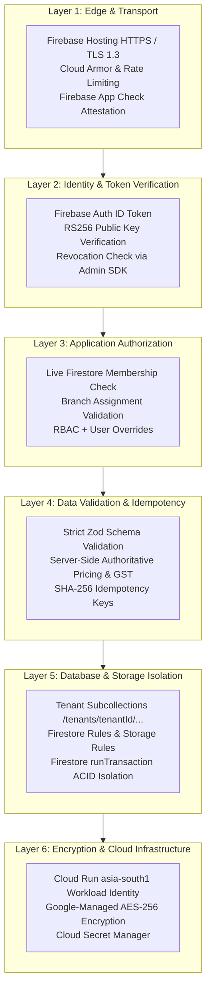

# PharmaDesk Security, Data Privacy & Backup Architecture

**Document Version:** 2.0.0 (Standardized Firebase-First Security Architecture)  
**Classification:** Confidential Engineering & Security Operations Document  
**Target Compliance:** DPDP Act 2023, ISO/IEC 27001 Controls, CDSCO Audit Guidelines  

---

## 1. Security Architecture & Threat Defense

PharmaDesk implements defense-in-depth across six standardized Firebase and Google Cloud layers:

---

## 2. Authentication & Authorization Controls

### 2.1 Token Verification Lifecycle
1. Firebase Authentication issues RS256 asymmetric ID tokens (60-minute expiry with automatic client SDK refresh).
2. The Express backend verifies tokens using `adminAuth().verifyIdToken(idToken, true)` via Firebase Admin SDK, detecting expired or revoked sessions immediately.
3. When `FIREBASE_APP_CHECK_REQUIRED=true`, requests must include a valid `X-Firebase-AppCheck` token verified via `appCheck().verifyToken(...)`.

### 2.2 Live Firestore Membership & Branch Resolution
The backend rejects static JWT custom claims as an authorization authority. On every protected request, `tenantAuthorizationMiddleware` reads `tenants/{tenantId}/memberships/{userId}` directly from Cloud Firestore:
- Verifies `membership.status === 'active'` (deactivated employees receive immediate HTTP `403 Forbidden`).
- Verifies `X-Branch-ID` against `membership.assignedBranchIds` (or `role === 'owner'` / `'*'`).
- Computes effective permissions via `resolveEffectivePermissions(role, permissionOverrides)` before any domain handler executes.

---

## 3. Cloud Firestore, Storage Rules & Service-Account Hygiene

### 3.1 Firestore & Storage Rules (Fail-Closed Default Deny)
- `firestore.rules`: Defaults to `allow read, write: if false`. All collections require `isMember(tenantId)` and collection-specific permission + branch validation. Append-only trails (`stock_movements`, `audit_logs`, `payments`, `returns`) block all client `update` and `delete` operations.
- `storage.rules`: Enforces `tenants/{tenantId}/branches/{branchId}/{category}/{fileName}` isolation, checks `hasBranchAccess(tenantId, branchId)`, restricts categories to `['invoice_pdfs', 'prescriptions', 'supplier_bills', 'product_images', 'documents']`, caps uploads under 15 MB, and permits only images and PDFs.

### 3.2 Service-Account & Credential Boundaries
- On Google Cloud Run (`asia-south1`), the Express backend uses Application Default Credentials (Workload Identity) with least-privilege IAM roles—never committed JSON keys.
- In local development, `.env` overrides remain excluded by `.gitignore` (`*service-account*.json`, `.env*`).
- Firebase Admin credentials are strictly prohibited from frontend Vite code (`VITE_*` variables contain only public client SDK identifiers).

---

## 4. Sensitive Patient Health Data & DPDP Act 2023

1. **Access Minimization & Purpose Limitation:**
   - Patient mobile numbers and addresses are hidden from the `helper` role.
   - Prescription scans and tax invoice PDFs reside in tenant/branch-scoped Firebase Storage paths accessed exclusively via short-lived (15-minute TTL) signed V4 URLs.
2. **Audit Logging:**
   - Security events, staff status changes, stock adjustments, sales returns, and invoice cancellations write immutable entries to `tenants/{tenantId}/audit_logs`.
3. **Configurable Statutory Retention:**
   - Tax invoices default to a 6-year archival baseline and prescription registers to a 3-year baseline (configurable per pharmacy in accordance with state counsel advice).

---

## 5. Backup, Disaster Recovery & Restore Testing

### 5.1 Recovery Objectives
- **Recovery Point Objective (RPO):** `< 5 minutes` (Cloud Firestore Point-in-Time Recovery [PITR] retains minute-level document history for 7 days).
- **Recovery Time Objective (RTO):** `< 30 minutes` via Cloud Firestore managed PITR / scheduled Cloud Storage export restoration in `asia-south1`.

### 5.2 Backup Automation
1. **Firestore Point-in-Time Recovery (PITR):** Enabled in `asia-south1` for granular document-level recovery.
2. **Scheduled Daily Firestore Exports:** Managed exports to a dedicated regional Cloud Storage backup bucket (`gs://<project>-firestore-backups/asia-south1`) retained for 30 rolling days.
3. **Cloud Run Stateless Failover:** Express API containers scale horizontally across `asia-south1` zones with zero local state or local filesystem storage dependency.
