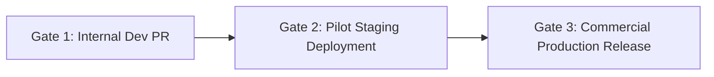

# PharmaDesk Comprehensive Testing Strategy & Quality Gates

**Document Version:** 1.0.0 (Implementation Blueprint)  
**Scope:** Verification Architecture across Database, Authorization, Transactions, and Integration  
**Standard:** Automated Quality Gates for Medical Store Reliability  

---

## 1. Testing Pyramid & Verification Framework

PharmaDesk operates in a mission-critical retail healthcare environment. Testing covers four synchronized layers:

```
                      / \
                     /   \
                    / E2E \   (Cypress / Playwright: Critical Counter POS Flows)
                   /-------\
                  /  Integ  \  (Jest/Supertest: Multi-tenant API + Cloud SQL + GCS)
                 /-----------\
                /  Transact   \ (ACID Concurrency: Locking, Stock Ledger, Ledgers)
               /---------------\
              /  Unit & Schema  \ (Vitest + pgTAP: Types, Triggers, RLS, Constraints)
             +-------------------+
```

---

## 2. Database & Relational Integrity Tests (pgTAP / SQL Tests)

### 2.1 Cross-Tenant Foreign Key Rejection Test
- **Objective:** Verify that composite foreign keys reject any cross-tenant linkage.
- **Test Case:**
  1. Insert Tenant A and Tenant B.
  2. Insert Medicine `med_A` under Tenant A.
  3. Attempt to insert an invoice item for Tenant B referencing `med_A`.
  4. **Assertion:** PostgreSQL raises `foreign_key_violation` (Error code `23503`). Insertion is blocked.

### 2.2 Row-Level Security (RLS) Leakage Test
- **Objective:** Confirm that queries cannot read rows belonging to other pharmacies.
- **Test Case:**
  1. Set session: `SET LOCAL app.current_tenant_id = 'tenant_A_uuid';`
  2. Execute `SELECT * FROM sales_invoices;`
  3. **Assertion:** Returns only invoices where `tenant_id = 'tenant_A_uuid'`. Zero rows from Tenant B appear.

### 2.3 Negative Stock Prevention Trigger Test
- **Objective:** Verify that `trg_check_inventory_stock` blocks inventory depletion below zero.
- **Test Case:**
  1. Seed batch with `current_stock = 2`.
  2. Execute `UPDATE inventory_batches SET current_stock = -1 WHERE id = :id;`
  3. **Assertion:** PostgreSQL raises `check_violation` (Error code `23514`). Transaction is aborted.

### 2.5 Negative Security Tests: Fail-Closed Context & Connection Pool Safety
- **Test 2.5.1: Missing Tenant Context (Fail-Closed Assertion)**
  - *Setup:* Connect to PostgreSQL using `pharmadesk_app` role without executing `SET LOCAL app.current_tenant_id`.
  - *Query:* `SELECT COUNT(*) FROM sales_invoices;`
  - *Assertion:* Returns exactly `0` rows. Because `NULLIF(current_setting('app.current_tenant_id', true), '')` evaluates to `NULL`, the RLS policy resolves to `FALSE` for all rows. Zero rows are leaked.
- **Test 2.5.2: Cross-Branch Access Rejection**
  - *Setup:* User authorized only for Branch 1 sets `X-Branch-ID: branch_2_uuid`.
  - *Query:* Backend validates against `membership_branches`.
  - *Assertion:* HTTP 403 Forbidden: `UNAUTHORIZED_BRANCH_ACCESS`.
- **Test 2.5.3: Runtime Application Role Privilege Test**
  - *Query:* `SELECT rolbypassrls, rolsuper FROM pg_roles WHERE rolname = 'pharmadesk_app';`
  - *Assertion:* Both `rolbypassrls` and `rolsuper` must be `FALSE`.
- **Test 2.5.4: Connection Pool Context Sanitization Test**
  - *Setup:* Checkout socket from pool $\rightarrow$ `BEGIN; SET LOCAL app.current_tenant_id = 'tenant_A'; COMMIT;` $\rightarrow$ release socket back to pool. Checkout same socket again $\rightarrow$ execute query without `SET LOCAL`.
  - *Assertion:* Returns `0` rows. Confirms that transaction conclusion purges session settings without requiring destructive `DISCARD ALL`.

---

## 3. Financial & Accounting Integrity Tests

### 3.1 Double-Entry Journal Balance Test
- **Objective:** Verify that `trg_check_journal_balance` enforces $\sum \text{Debit} = \sum \text{Credit}$.
- **Test Case:**
  1. Insert journal entry with Debit = 500.00, Credit = 400.00.
  2. **Assertion:** Database raises `check_violation` (Error code `23514`). Unbalanced journals cannot be committed.

### 3.2 Sales Invoice Immutability Test
- **Objective:** Verify that `trg_protect_sales_invoices` prohibits modifying committed financial numbers.
- **Test Case:**
  1. Create issued invoice with `grand_total = 1000.00`.
  2. Attempt `UPDATE sales_invoices SET grand_total = 800.00 WHERE id = :id;`
  3. **Assertion:** Database raises `restrict_violation`. The update is aborted.

### 3.3 Financial Metric Calculation Test
- **Objective:** Verify that Net Profit formula accounts for COGS and operating expenses correctly.
- **Assertion:**
  $$\text{Net Profit} = \text{Net Revenue} - \text{COGS} - \text{Expenses}$$
  Assert that calculations do not compute Net Profit as Gross Sales minus Expenses.

## 4. Authorization & RBAC Tests

| Test Suite | Scenario Tested | Expected Result |
| :--- | :--- | :--- |
| **Owner Boundary** | Owner updates store drug license (Form 20B/21B) | HTTP 200 OK |
| **Cashier Privilege Cap** | Cashier attempts to modify medicine salt composition (`medicines.edit`) | HTTP 403 Forbidden |
| **Helper Data Protection** | Helper queries patient phone numbers (`customers.view`) | HTTP 403 Forbidden |
| **User Override Grant** | Cashier with explicit grant applies 15% discount (`billing.discount`) | HTTP 200 OK |
| **User Override Revoke** | Pharmacist with explicit denial attempts stock count adjustment | HTTP 403 Forbidden |
| **Immediate Revocation** | Deactivated staff user attempts to bill using previously valid token | HTTP 403 Forbidden |
| **Cross-Tenant Impersonation**| User from Tenant A sends `X-Tenant-ID: tenant_B` | HTTP 403 Forbidden |

---

## 5. High-Velocity Business Transaction Tests

### 5.1 Concurrent POS Checkout Race Condition
- **Objective:** Prevent two cashiers from overselling the final remaining stock.
- **Simulation:** Two asynchronous processes submit `POST /billing/invoices` requesting 1 pack each of a batch with only 1 pack remaining.
- **Assertion:**
  - Exactly one request succeeds with HTTP 201 Created and decrements stock to 0.
  - The second request receives HTTP 409 Conflict (`STOCK_EXHAUSTED`).
  - Net batch stock is exactly 0 (never negative).

### 5.2 Idempotent Duplicate Submission
- **Objective:** Prevent double-billing when a cashier double-clicks "Print & Complete".
- **Simulation:** Submit the exact same payload twice with identical `Idempotency-Key` header.
- **Assertion:**
  - First request returns HTTP 201 Created and creates invoice.
  - Second request returns HTTP 200 OK with the identical invoice payload without creating a second invoice or double-deducting stock.

### 5.3 Goods Receipt & Purchase Inward Transaction
- **Simulation:** Inward 100 packs of Augmentin 625 Duo.
- **Assertion:**
  - `inventory_batches` count increases by 100.
  - An inward row is created in `stock_movements`.
  - Accounts payable balance in `supplier_ledger` increases by invoice total.
  - Double-entry journal matches across inventory asset and accounts payable.

---

## 6. Quality Release Gates



### Gate 1: Internal Development PR
- TypeScript builds cleanly with zero errors (`tsc --noEmit`).
- 100% of schema constraints, composite FKs, and RLS tests pass.
- Unit tests pass for tax calculations (reverse inclusive MRP derivation).

### Gate 2: Pilot Staging Deployment
- End-to-end integration test passes: Onboarding $\rightarrow$ Inward Stock $\rightarrow$ Counter Dispense $\rightarrow$ Khata Settlement.
- Idempotency and concurrent checkout race condition tests pass.
- Performance: Single-line POS checkout response time $\le 200\text{ms}$ at 95th percentile.

### Gate 3: Commercial Production Release
- Disaster recovery drill executed: Database restored from snapshot and verified in under 30 minutes.
- Audit logging verified for Schedule H1 controlled dispensing.
- Independent qualified review completed by a registered Indian pharmacist and certified GST practitioner.
